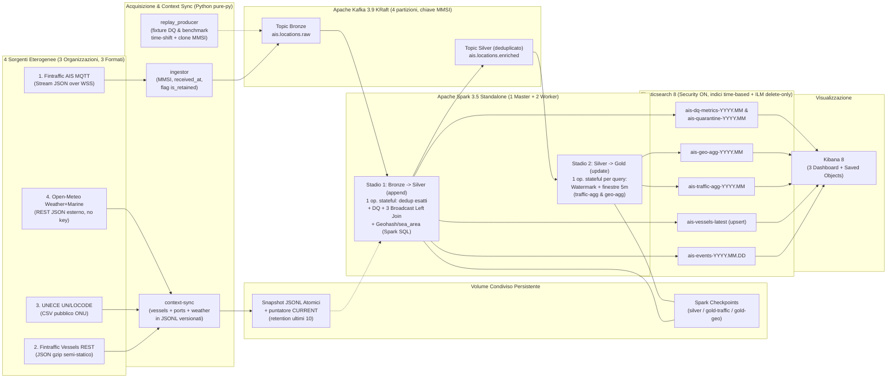

# Smart Port — Specifica Tecnica e Architetturale (Ground Truth)

> **Ruolo di questo documento:** fonte di verità unica (*Single Source of Truth*) per la progettazione, l'implementazione, il testing, il deploy e la documentazione del progetto universitario **Smart Port** (corso LSDM — traccia *Big Data Processing*). Ogni modulo deve aderire ai contratti, agli schemi e agli invarianti definiti in questo documento.

---

## 1. Perimetro e Obiettivi del Progetto

### 1.1 Obiettivo
Costruire una pipeline Big Data modulare, riproducibile e portabile (Mac locale Apple Silicon 16 GB RAM ↔ singola VM cloud Linux `arm64`/`amd64`) per acquisire, integrare, validare, elaborare in modo distribuito con **Apache Spark** e visualizzare in **Kibana** il traffico marittimo AIS nell'area finlandese/baltica.

### 1.2 Requisiti della Traccia Universitaria (Nucleo Obbligatorio)
- Scenario che motivi l'analisi Big Data su volume, frequenza, eterogeneità e qualità dei dati.
- **Data Ingestion** continua da sorgente reale (MQTT over WebSocket) con disaccoppiamento tramite **Apache Kafka**.
- **Data Integration** reale tra sorgenti eterogenee (organizzazioni, formati, schemi e chiavi diversi).
- **Data Quality** osservabile: validazione, normalizzazione, deduplicazione, gestione eventi tardivi/fuori ordine, quarantena scarti e metriche di qualità/copertura.
- **Calcolo distribuito** con **Apache Spark 3.5** (cluster con più worker/executor) per aggregazioni temporali e geografiche.
- **Memorizzazione persistente** con **Elasticsearch 8** (mapping espliciti, idempotenza, politiche di retention).
- **Cruscotti interattivi** in **Kibana 8** (mappa operativa live, analisi del traffico, monitoraggio qualità dati) esportabili come Saved Objects, più capacità di creare una visualizzazione live all'orale.
- **Riproducibilità** tramite **Docker Compose**, configurazione separata da codice/credenziali e guida al deploy cloud.

### 1.3 Esplicitamente Fuori Scope
- Machine Learning, NLP, previsione di rotte o ETA.
- Frontend web o motore cartografico custom (si usa esclusivamente Kibana).
- Sistemi certificati di sicurezza della navigazione o anticollisione.
- Kubernetes e servizi cloud gestiti a pagamento obbligatori.
- Benchmark di table format (Iceberg, Hudi, Delta Lake).

---

## 2. Architettura di Sistema

### 2.1 Diagramma End-to-End



### 2.2 Stack Tecnologico e Compatibilità Multi-Arch (`linux/arm64` + `linux/amd64`)

| Componente | Immagine / Libreria | Motivazione tecnica |
|---|---|---|
| Message Broker | `apache/kafka:3.9.0` (KRaft single-node) | Ufficiale multi-arch, zero ZooKeeper, partizionamento per `mmsi`, disaccoppiamento Stadio 1 ↔ Stadio 2 |
| Elaborazione | `apache/spark:3.5.5-python3` (1 Master + 2 Worker) | Ufficiale multi-arch; JAR `spark-sql-kafka-0-10_2.12:3.5.5` pre-scaricati in build |
| Storage Serving | `docker.elastic.co/elasticsearch/elasticsearch:8.17.4` | Ufficiale multi-arch, single-node, `xpack.security.enabled=true` |
| Visualizzazione | `docker.elastic.co/kibana/kibana:8.17.4` | Ufficiale multi-arch, Maps + Lens + Saved Objects API |
| Servizi Python | `python:3.12-slim` | `paho-mqtt>=2.0`, `kafka-python-ng` (pure Python, zero compilazione C su ARM64), `requests`, `elasticsearch>=8.15,<9.0` |
| Scrittura Spark → ES | `foreachPartition` + `elasticsearch-py` (`helpers.bulk`) | Evita incompatibilità note di `elasticsearch-spark-30` su Spark 3.5; supporta auth ES 8, routing time-based e scripted upsert condizionale distribuito per partizione |

### 2.3 Budget Risorse (Profilo Locale Mac 16 GB RAM ↔ Scalabile in Cloud via `.env`)

| Servizio | Heap / Tuning Locale | Limit Container | RSS Reale Stimata |
|---|---|---:|---:|
| `kafka` | `KAFKA_HEAP_OPTS="-Xms256m -Xmx384m"` | `640 MB` | ~`500 MB` |
| `elasticsearch` | `ES_JAVA_OPTS="-Xms768m -Xmx768m"` | `1.5 GB` | ~`1.2 GB` |
| `kibana` | `NODE_OPTIONS="--max-old-space-size=768"` | `1.0 GB` | ~`850 MB` |
| `spark-master` | `SPARK_DAEMON_MEMORY=256m` | `384 MB` | ~`300 MB` |
| `spark-worker-1` | `1 core`, `SPARK_WORKER_MEMORY=768m`, executor `640m` | `1.1 GB` | ~`950 MB` |
| `spark-worker-2` | `1 core`, `SPARK_WORKER_MEMORY=768m`, executor `640m` | `1.1 GB` | ~`950 MB` |
| `spark-app` (Driver) | `--driver-memory 640m`, `spark.sql.shuffle.partitions=4` | `1.0 GB` | ~`850 MB` |
| `ingestor` + `context-sync` | Pure Python (no `pyarrow`/`pandas`) | `256 MB` tot | ~`180 MB` |
| **Totale** | | **~7.0 GB** | **~5.8 – 6.5 GB** |

### 2.4 Garanzie di Consegna e Consistenza
- **Semantica end-to-end:** **at-least-once** con **sink Elasticsearch idempotenti**.
- Non esiste una transazione distribuita tra Elasticsearch e Kafka nel `foreachBatch` dello Stadio 1: per minimizzare il rischio di duplicati verso lo Stadio 2, la scrittura su Kafka `ais.locations.enriched` avviene **sempre per ultima** (solo dopo completamento delle scritture ES).
- L'idempotenza su Elasticsearch è garantita combinando **`_id` deterministico** e **indici time-based deterministici** (instradati sull'`event_time` / `window_start` del documento, **mai** ILM rollover o Data Stream).

---

## 3. Sorgenti Dati e Contratto di Data Integration

### 3.1 Le 4 Sorgenti Integrate

| # | Sorgente | Organizzazione | Protocollo / Formato | Licenza & Limiti | Frequenza |
|---|---|---|---|---|---|
| 1 | **Digitraffic AIS Locations** (`wss://meri.digitraffic.fi:443/mqtt`, `vessels-v2/+/location`) | Fintraffic (FI) | MQTT over WSS / JSON | CC BY 4.0, no API key, client ID descrittivo | Continuo (~35 msg/s) |
| 2 | **Digitraffic AIS Vessels** (`https://meri.digitraffic.fi/api/ais/v1/vessels`) | Fintraffic (FI) | REST / JSON (`Accept-Encoding: gzip`, `Digitraffic-User` obbligatori) | CC BY 4.0, cache 1m, max 60 req/min | Sync ogni 60 min |
| 3 | **UNECE UN/LOCODE** (`data_static/unlocode_ports.csv`) | UNECE (ONU) | File CSV tabellare (porti marittimi globali, ~1 MB) | CC BY 4.0 | Statico all'avvio |
| 4 | **Open-Meteo Weather & Marine** (`api.open-meteo.com/v1/forecast` + `marine-api.open-meteo.com/v1/marine`) | Open-Meteo | REST / JSON (multi-punto) | CC BY 4.0 uso non commerciale, no API key, 10k req/giorno | Sync ogni 60 min (2 chiamate HTTP/ora) |

### 3.2 I 3 Pattern di Data Integration nel Nucleo

1. **Stream-Static Entity Join (`MMSI`):** riconciliazione posizioni live MQTT ⋈ snapshot anagrafica `vessels` (garantita univoca 1:1 per `mmsi`). Gli eventi privi di corrispondenza sono preservati con `metadata_matched = false`.
2. **Entity Resolution & Schema Mediation (`voyage_destination` ⋈ UNECE UN/LOCODE):** normalizzazione conservativa (*Precision > Recall*) del campo testuale sporco `destination` contro il dizionario ONU dei porti marittimi: **match globale sui codici UN/LOCODE a 5 caratteri** (univoci a livello mondiale) e **match sui nomi testuali liberi circoscritto al bacino Baltico / Nord Europa** (`FI, SE, EE, LV, LT, PL, DE, DK, NO, RU, NL, BE, GB`) solo se univoco. Nessuna associazione arbitraria per destinazioni ambigue o multi-scalo.
3. **Spatial-Temporal Join Multi-Provider (`(sea_area, weather_hour_utc)`):** associazione del contesto meteo-marino modellistico orario di Open-Meteo (su 8–10 zone costiere/marittime baltiche) agli eventi e alle finestre AIS.

---

## 4. Modello Dati Canonico e Semantica delle Metriche

### 4.1 Layer Bronze (`ais.locations.raw`)
Envelope JSON prodotto dall'ingestor:
- `mmsi` (`string`, estratto dal topic MQTT)
- `topic` (`string`)
- `received_at` (`string` ISO-8601 UTC)
- `is_retained` (`boolean`, da `msg.retain`)
- `raw_payload` (`string`, payload JSON grezzo non alterato)

### 4.2 Layer Silver (`ais-events-YYYY.MM.DD` & `ais.locations.enriched`)

| Gruppo | Campi principali | Provenienza / Semantica esatta |
|---|---|---|
| **Identità & Tempo** | `dedup_hash`, `mmsi`, `event_time` (`@timestamp`, UTC), `received_at`, `latency_sec`, `is_late_event`, `is_retained` | Da Bronze; `dedup_hash = sha256(mmsi, event_time, round(lat,5), round(lon,5), sog, cog, heading, navStat)` |
| **Cinematica pulita** | `location` (`geo_point`: `lat`/`lon`), `sog`, `cog`, `heading`, `rot`, `nav_stat`, `nav_stat_label`, `pos_acc`, `raim` | Sentinelle AIS (`heading=511`, `rot=-128`, `cog>=360`, `sog>=102.2`) convertite in `null` |
| **Qualità & Movimento** | `movement_status` (`stationary`/`maneuvering`/`underway`/`unknown`), `nav_stat_mismatch`, `had_sentinel_fields` | `movement_status` derivato da `sog` (`<0.5`, `0.5–3.0`, `>=3.0`); `nav_stat_mismatch = (sog < 0.5 and nav_stat == 0)` |
| **Spazio** | `geohash_5`, `cell_centroid` (`geo_point`), `sea_area`, `weather_hour_utc`, `time_slot` | Calcolati in puro Spark SQL su 8–10 macro-aree baltiche |
| **Anagrafica stabile** | `metadata_matched`, `vessel_name`, `imo`, `call_sign`, `ship_type_code`, `ship_category`, `length_m`, `beam_m`, `flag_country`, `metadata_snapshot_id` | Da `vessels` REST (campi stabili) + lookup AIS/MID |
| **Viaggio & Entity Res.** | `voyage_destination_raw`, `voyage_draught_m`, `voyage_eta_raw`, `dest_resolution_status`, `dest_locode`, `dest_port_name`, `dest_country`, `dest_route_locodes`, `geodesic_dist_to_dest_km` | Da `vessels` + UNECE UN/LOCODE. `geodesic_dist_to_dest_km` è **linea d'aria geodetica** (non distanza navigabile), calcolata **solo** se `dest_resolution_status` inizia con `RESOLVED_` |
| **Contesto Meteo** | `weather_matched`, `area_wind_speed_kn`, `area_wind_gusts_kn`, `area_wind_dir_deg`, `area_wave_height_m`, `area_wave_period_s`, `sea_state_class`, `weather_is_model`, `weather_snapshot_id` | Da Open-Meteo per `(sea_area, weather_hour_utc)`. Dati **modellistici d'area orari**, non misure puntuali di bordo |

### 4.3 Layer Gold (`ais-traffic-agg-YYYY.MM` & `ais-geo-agg-YYYY.MM`)
- **`ais-traffic-agg-YYYY.MM` (finestra tumbling `5 min`, `update` mode):**
  - Dimensioni: `window_start` (`@timestamp`), `window_end`, `agg_level` (`global` | `by_area` | `by_category` | `by_area_category`), `sea_area`, `ship_category`, `movement_status`.
  - Metriche: `msg_count`, `distinct_vessels_est` (`approx_count_distinct`), `avg_sog_obs_all` (**per rilevazione**), `avg_sog_obs_moving` (**per rilevazione**, `sog >= 0.5`), `avg_area_wind_speed_kn`, `avg_area_wave_height_m`.
  - **Regola di non-additività:** in Kibana `distinct_vessels_est` **non va mai sommato** tra finestre o dimensioni; per serie temporali si seleziona un solo `agg_level` alla volta; per conteggi distinti su intervalli liberi si usa `cardinality(mmsi)` su `ais-events-*`.
- **`ais-geo-agg-YYYY.MM` (finestra tumbling `5 min`, `update` mode):**
  - Dimensioni: `window_start` (`@timestamp`), `window_end`, `geohash_5`, `sea_area`, `cell_centroid` (`geo_point`).
  - Metriche: `msg_count`, `distinct_vessels_est`, `stationary_vessels_est`, `underway_vessels_est`, `avg_sog_obs_moving`, `avg_area_wave_height_m`.
  - **Semantica:** indica *concentrazione / presenze di navi distinte nella cella nella finestra* (non sommabile tra celle adiacenti e non equivalente a congestione accertata).

### 4.4 Stato Corrente, Qualità e Quarantena
- **`ais-vessels-latest`:** 1 documento per `mmsi` (`_id = mmsi`, scripted upsert condizionale). Fornisce le ultime posizioni osservate sulla mappa e la **velocità media esatta per nave attiva** (senza bias da frequenza di trasmissione AIS).
- **`ais-dq-metrics-YYYY.MM`:** metriche per micro-batch (`total_msgs`, `valid_msgs`, `invalid_msgs`, `exact_duplicate_msgs`, `same_second_events`, `retained_msgs`, `late_event_msgs`, `nav_stat_mismatch_msgs`, `sentinel_counts.*`, `vessel_matched_pct`, `dest_resolved_pct`, `dest_status_counts.*`, `weather_matched_pct`, `latency_p50_sec`, `latency_p95_sec`, `metadata_snapshot_age_min`).
- **`ais-quarantine-YYYY.MM`:** record strutturalmente scartati con `rejection_reasons` (`INVALID_JSON`, `INVALID_MMSI`, `INVALID_COORDS`, `INVALID_TIMESTAMP`) e `raw_payload`.

---

## 5. Struttura del Repository

```text
smartPort/
├── PROJECT_SPEC.md                   # Questo documento (Ground Truth)
├── AGENTS.md                         # Regole operative e workflow dell'agente
├── DEVELOPMENT_LOG.md                # Registro cronologico di sviluppo e verifiche
├── .env.example                      # Template variabili, credenziali e tuning risorse
├── .gitignore                        # Esclude .env, *.jsonl, data/, checkpoints/
├── docker-compose.yml                # Stack multi-arch locale/cloud (porte solo 127.0.0.1)
├── Makefile                          # Target standard di avvio, test, probe, export Kibana
├── pyproject.toml                    # Gestione dipendenze dev/test con uv
│
├── scripts/
│   └── probe_sources.py              # MODULO 0 — Verifica sperimentale delle 4 sorgenti
│
├── data_static/
│   └── unlocode_ports.csv            # Porti marittimi UNECE UN/LOCODE con coordinate (CC BY 4.0)
│
├── infra/                            # MODULO 1 — Bootstrap Kafka & Elasticsearch
│   ├── kafka/init-topics.sh
│   └── es/
│       ├── init-es.sh
│       ├── ilm/
│       └── templates/
│
├── services/
│   ├── ingestor/                     # MODULO 2 — MQTT Digitraffic -> Kafka Bronze
│   ├── context_sync/                 # MODULO 3 — Sync Vessels + UN/LOCODE + Open-Meteo
│   ├── spark_app/                    # MODULO 4 — Pipeline Spark Structured Streaming
│   └── replay/                       # MODULO 6 — Fixture DQ & Benchmark controllato
│
├── kibana/                           # MODULO 5 — Dashboard versionate + script import/export
│   ├── dashboards/
│   ├── export_dashboards.sh
│   └── import_dashboards.sh
│
├── tests/                            # MODULO 6 — Suite pytest (eseguibile con uv senza Docker)
└── docs/                             # MODULO 7 — Documentazione tesina & deploy cloud
```

---

## 6. Specifica dei Moduli da Implementare

I moduli sono ordinati per dipendenza. Ogni modulo va implementato e verificato rispetto alla propria *Definition of Done* prima di passare al successivo.

---

### Modulo 0 — Verifica Sperimentale delle Sorgenti *(Gate Pre-Implementazione)*

- **Percorso:** `scripts/probe_sources.py`, `data_static/unlocode_ports.csv`, `docs/source_validation_report.md`
- **Dipendenze:** nessuna (eseguibile con `uv`, senza Docker).
- **Scopo:** misurare sperimentalmente schemi reali, disponibilità, volumi, limiti e tassi di riconciliazione di tutte e 4 le sorgenti prima di congelare `schemas.py` e i servizi.
- **Attività richieste:**
  1. Cattura MQTT Digitraffic di **15 minuti** (`vessels-v2/+/location` e `status`): misurare msg/s, navi distinte, presenza di `msg.retain == True`, latenza p50/p95/p99/max, eventi out-of-order, collisioni sub-secondo e duplicati esatti.
  2. Chiamata live a `GET https://meri.digitraffic.fi/api/ais/v1/vessels` (`Accept-Encoding: gzip`, `Digitraffic-User`): registrare nomi esatti dei campi JSON, dimensione payload, numero di MMSI, eventuali duplicati e **% reale di match MMSI** rispetto al campione MQTT da 15 min.
  3. Acquisizione/estrazione di `data_static/unlocode_ports.csv` da UNECE UN/LOCODE (tutti i porti marittimi con `Function` contenente `1` e coordinate valide) e test empirico delle regole conservative di Entity Resolution (codici globali + nomi circoscritti a Baltico/Nord Europa) sulle destinazioni reali di `/api/ais/v1/vessels`, misurando anche la quota di destinazioni baltiche vs europee vs extra-europee.
  4. Chiamata batch multi-punto a **Open-Meteo Weather + Marine** sugli 8–10 punti marittimi baltici (`cell_selection=sea`): verificare che vento e `wave_height` siano valorizzati (non `null`) e registrare schema e latenza.
- **Definition of Done:**
  - [ ] `docs/source_validation_report.md` popolato con numeri reali misurati per tutte e 4 le sorgenti.
  - [ ] Conferma empirica della soglia di watermark (default `2 minutes`, aggiornabile in base al p99 reale).
  - [ ] `data_static/unlocode_ports.csv` validato e salvato nel repository.

---

### Modulo 1 — Infrastruttura Docker Compose, Rete & Sicurezza

- **Percorso:** `docker-compose.yml`, `.env.example`, `Makefile`, `infra/kafka/init-topics.sh`, `infra/es/init-es.sh`, `infra/es/ilm/*.json`, `infra/es/templates/*.json`
- **Dipendenze:** Modulo 0 (per i campi definitivi dei mapping ES).
- **Scopo:** fornire l'infrastruttura riproducibile multi-arch con bootstrap zero-touch (Kafka KRaft, Spark 1 Master + 2 Worker, Elasticsearch 8 con security, Kibana 8).
- **Contratti tecnici:**
  - Rete Docker interna `smartport-net`; volumi persistenti separati (`kafka_data`, `es_data`, `kibana_data`, `shared_data` per snapshot e checkpoint Spark).
  - Tutte le porte esposte sull'host bindate **esclusivamente** su `127.0.0.1` (`5601` Kibana, `8080` Spark Master UI, `9200` ES); Kafka `9092` e Spark `7077` solo interni.
  - `kafka-init` (one-shot idempotente): crea `ais.locations.raw` e `ais.locations.enriched` con `4` partizioni, `replication-factor=1`, `retention.ms=86400000` (24h), `retention.bytes=2147483648` (2 GB).
  - `es-init` (one-shot idempotente): imposta password `kibana_system` via REST API, registra le policy ILM **delete-only** (nessun rollover: `3d`/`7d` per `ais-events-*`, `14d` per `ais-dq-metrics-*` e `ais-quarantine-*`, `30d` per `ais-traffic-agg-*` e `ais-geo-agg-*`) e crea gli Index Templates con mapping espliciti (`@timestamp`, `geo_point`, `keyword`) più l'indice fisso `ais-vessels-latest`.
- **Definition of Done:**
  - [ ] `docker compose up -d` su ambiente pulito porta tutti i servizi in stato `healthy` senza interventi manuali.
  - [ ] Spark Master UI (`http://127.0.0.1:8080`) mostra **2 Worker `ALIVE`**.
  - [ ] Elasticsearch rifiuta richieste anonime e risponde con credenziali da `.env`; i 6 template/indici e le 3 policy ILM sono presenti.
  - [ ] Kibana (`http://127.0.0.1:5601`) è accessibile con login `elastic`.
  - [ ] Consumo RAM complessivo verificato con `docker stats` entro **≤ 7 GB RSS**.

---

### Modulo 2 — Ingestion Streaming AIS

- **Percorso:** `services/ingestor/` (`Dockerfile`, `requirements.txt`, `src/config.py`, `src/mqtt_client.py`, `src/kafka_producer.py`, `src/main.py`)
- **Dipendenze:** Modulo 1 (Kafka attivo).
- **Scopo:** acquisire continuamente lo stream MQTT Digitraffic e pubblicarlo nel topic Kafka Bronze `ais.locations.raw`.
- **Contratti tecnici:**
  - Connessione WSS a `meri.digitraffic.fi:443/mqtt` con `paho-mqtt>=2.0` (`CallbackAPIVersion.VERSION2`), sottoscrizione a `vessels-v2/+/location` e `vessels-v2/status`, reconnessione con backoff esponenziale.
  - Producer Kafka via `kafka-python-ng` (pure Python), chiave `mmsi` (UTF-8), `acks='all'`, compressione `gzip`, gestione errori di rete senza arresto del processo.
  - Envelope JSON conforme alla Sezione 4.1 (`mmsi`, `topic`, `received_at`, `is_retained`, `raw_payload`). Non scarta JSON malformati (li inoltra a Spark per visibilità nella quarantena).
  - Log strutturato ogni 30s (`msgs_in`, `msgs_sent`, `retained_count`, `send_errors`).
- **Definition of Done:**
  - [ ] Il container si connette a Digitraffic e popola `ais.locations.raw` su tutte e 4 le partizioni (~35 msg/s).
  - [ ] Dopo un riavvio forzato di Kafka (`docker compose restart kafka`), l'ingestor riconnette e riprende la pubblicazione automaticamente.

---

### Modulo 3 — Sincronizzazione Sorgenti di Contesto (`context-sync`)

- **Percorso:** `services/context_sync/` (`Dockerfile`, `requirements.txt`, `src/config.py`, `src/lookups.py`, `src/vessels_sync.py`, `src/ports_builder.py`, `src/weather_sync.py`, `src/atomic_io.py`, `src/main.py`)
- **Dipendenze:** Modulo 0 (schemi reali verificati e CSV UN/LOCODE), Modulo 1 (volume condiviso `shared_data`).
- **Scopo:** acquisire, normalizzare e pubblicare su volume condiviso gli snapshot JSONL atomici delle 3 sorgenti complementari (`vessels`, `ports`, `weather`).
- **Contratti tecnici:**
  - **Zero dipendenze native C/C++** (niente `pyarrow`/`pandas`; solo `requests` + stdlib `csv`/`json`).
  - **`atomic_io.py`:** scrive in `<dir>/.tmp_<ts>.jsonl`, esegue `os.replace` verso `<dir>/<dataset>_v<ts>.jsonl`, aggiorna atomicamente `<dir>/CURRENT` e conserva gli **ultimi 10 snapshot** (evitando `FileNotFoundException` in Spark). Se un fetch fallisce o produce `< soglia` righe valide, **non aggiorna `CURRENT`**.
  - **`vessels_sync.py` (ogni 60 min):** scarica `/api/ais/v1/vessels` (`Accept-Encoding: gzip`, `Digitraffic-User`), deduplica rigorosamente 1 riga per `mmsi` (per `timestamp` max), trimma stringhe, converte `0` in `null` per `imo`/`draught`/dimensioni, applica lookup `ship_category` (AIS type) e `flag_country` (MID MMSI), separa campi stabili da `voyage_*`.
  - **`ports_builder.py` (all'avvio):** legge `data_static/unlocode_ports.csv` (porti marittimi globali UN/LOCODE con coordinate), converte coordinate DMS→decimali, imposta `is_nordic_baltic_scope = (country in {FI, SE, EE, LV, LT, PL, DE, DK, NO, RU, NL, BE, GB})` e marca eventuali nomi omonimi dentro lo scope regionale (`is_ambiguous_name = true/false`) così Spark non effettua mai associazioni arbitrarie.
  - **`weather_sync.py` (ogni 60 min):** interroga Open-Meteo Weather + Marine in **2 sole chiamate HTTP multi-punto** sulle 8–10 zone marittime baltiche definite in `lookups.py` (finestra 24h passate + 6h future), producendo 1 riga per `(sea_area, weather_hour_utc)` con vento in nodi, onde in metri, `sea_state_class` e `weather_is_model = true`.
- **Definition of Done:**
  - [ ] All'avvio produce i 3 file `CURRENT` validi (`vessels`, `ports`, `weather`) in `/data/reference/`.
  - [ ] Unicità 1:1 verificata su `mmsi` (`vessels`) e `(sea_area, weather_hour_utc)` (`weather`).
  - [ ] `tests/test_context_sync.py` passa al 100%.

---

### Modulo 4 — Elaborazione Distribuita Spark Structured Streaming (`spark_app`)

Diviso internamente in **due sotto-moduli** per testabilità rapida: prima tutta la logica pura su DataFrame (testabile con `uv run pytest` senza Docker), poi l'integrazione streaming verso Kafka ed Elasticsearch.

#### Sotto-modulo 4.1 — Logica di Dominio Pura (Puro Spark SQL, Zero Python UDF nei Worker)
- **File:** `services/spark_app/src/{config,schemas,cleaning,spatial,entity_resolution,enrichment,aggregations}.py`
- **Contratti tecnici:**
  - **`cleaning.py`:** valida `raw_payload` (schema esplicito da Modulo 0), separa record validi e quarantena (`rejection_reasons`), normalizza UTC e sentinelle AIS (`heading=511`, `rot=-128`, `cog>=360`, `sog>=102.2`, `navStat=15`), calcola `latency_sec`, `is_late_event`, `nav_stat_mismatch`, `movement_status` e `dedup_hash`.
  - **`spatial.py`:** calcola `geohash_5` e `cell_centroid` (in puro Spark SQL senza librerie C né Python UDF), assegna `sea_area` (8–10 zone baltiche) e calcola `geodesic_dist_to_dest_km` (Haversine in Spark SQL, solo quando `dest_resolution_status` è `RESOLVED_*`).
  - **`entity_resolution.py`:** implementa la macchina a stati conservativa su `voyage_destination_raw`:
    - `EMPTY` → stringa nulla/vuota
    - `MULTI_LEG_ROUTE` → presenza separatori multi-scalo (`<>`, `<->`, `/`, `->`, o 2+ LOCODE); popola `dest_route_locodes` ma lascia `dest_locode = null` e `geodesic_dist_to_dest_km = null`
    - `OPERATIONAL_OR_AREA` → pattern operativi (`PILOT`, `AREA`, `WORKS`, `GULF`, `SEA`, `SAR`, `PATROL`, `ORDERS`)
    - `RESOLVED_EXACT_LOCODE` → match esatto 5 char su `ports` (lookup **globale**, codici univoci al mondo)
    - `RESOLVED_SPACED_LOCODE` → formato `XX YYY` o `LOCODE + suffisso` (`RDS`, `ANCH`, `PORT`) su `ports` (lookup **globale**)
    - `RESOLVED_UNAMBIGUOUS_NAME` → match esatto su nome porto **solo con `is_nordic_baltic_scope == true`** e `is_ambiguous_name == false`
    - `AMBIGUOUS` → match su nome omonimo in `is_nordic_baltic_scope == true` (`is_ambiguous_name == true`); `dest_locode = null`
    - `UNRESOLVED` → nessun match; `dest_locode = null`
  - **`enrichment.py`:** `SnapshotLoader` legge `CURRENT` (o `PINNED_*_SNAPSHOT` se impostato per replay), ricarica il JSONL solo al cambio versione, esegue i **3 Broadcast Left Join** garantendo che il conteggio righe in uscita sia sempre identico a quello in ingresso (`count_out == count_in`), e propaga `metadata_snapshot_id` e `weather_snapshot_id`.
  - **`aggregations.py`:** definisce le trasformazioni per `ais-traffic-agg` (finestra `5 min`, `groupingSets` su `agg_level`: `global`, `by_area`, `by_category`, `by_area_category`) e `ais-geo-agg` (finestra `5 min`, `geohash_5`, `sea_area`).

#### Sotto-modulo 4.2 — Streaming Runtime, Sink ES e Container Spark
- **File:** `services/spark_app/{Dockerfile,requirements.txt}`, `services/spark_app/src/{es_sink,stage_silver,stage_gold,main}.py`
- **Dipendenze:** Modulo 1, Modulo 2, Modulo 3, Sotto-modulo 4.1.
- **Contratti tecnici:**
  - **`Dockerfile`:** base `apache/spark:3.5.5-python3`, JAR `spark-sql-kafka-0-10_2.12:3.5.5` pre-baked in `/opt/spark/jars/`, installazione `elasticsearch>=8.15,<9.0`.
  - **`stage_silver.py` (`append` mode, trigger `15s`, checkpoint `/data/checkpoints/silver`):**
    - **1 solo operatore stateful:** `withWatermark("event_time", WATERMARK_DELAY).dropDuplicates(["dedup_hash"])` (deduplica soli duplicati esatti cross-batch/intra-batch senza aggiungere latenza; preserva le collisioni sub-secondo e le conta come `same_second_events`).
    - Nel `foreachBatch`: esegue enrichment + metriche DQ → scrive su ES (`ais-quarantine-YYYY.MM`, `ais-events-YYYY.MM.DD`, `ais-vessels-latest`, `ais-dq-metrics-YYYY.MM`) → **per ultimo** scrive i soli validi con `is_retained == false` su Kafka `ais.locations.enriched`.
  - **`stage_gold.py` (`update` mode, trigger `30s`, 2 query concorrenti indipendenti):**
    - **Query Gold Traffic** (checkpoint `/data/checkpoints/gold-traffic`): legge `ais.locations.enriched` → `withWatermark` + `groupBy(window 5m, groupingSets)` → upsert su `ais-traffic-agg-YYYY.MM`.
    - **Query Gold Geo** (checkpoint `/data/checkpoints/gold-geo`): legge `ais.locations.enriched` → `withWatermark` + `groupBy(window 5m, geohash_5, sea_area)` → upsert su `ais-geo-agg-YYYY.MM`.
    - **Zero chaining di operatori stateful in `update` mode** (invariante Spark 3.5).
  - **`es_sink.py`:** `df.foreachPartition` con `elasticsearch.helpers.bulk`, instradamento per indice time-based dal timestamp del singolo documento, `_id` deterministico, e **scripted upsert Painless** su `ais-vessels-latest` (aggiorna se `event_time > existing`, oppure a parità di `event_time` se `received_at >= existing` e non degrada `sog` a `null`).
  - **`main.py`:** avvia Stadio 1 + Stadio 2 nello stesso `SparkSession` (`--stage all|silver|gold`, default `all`), `spark.sql.shuffle.partitions=4` (configurabile da `.env`), registra un `StreamingQueryListener` per loggare `inputRowsPerSecond`, `processedRowsPerSecond`, `batchDurationMs`.
- **Definition of Done:**
  - [ ] Tutti i test unitari (`test_cleaning`, `test_spatial`, `test_entity_resolution`, `test_enrichment`, `test_aggregations`) passano al 100% con `uv run pytest`.
  - [ ] Pipeline live in esecuzione sui **2 Worker Spark** (task distribuiti visibili in Spark UI) con 0 errori e popolamento continuo dei 6 pattern di indici Elasticsearch.
  - [ ] Test di riavvio (`docker compose restart spark-app`) riprende dai checkpoint senza duplicare documenti su Elasticsearch.

---

### Modulo 5 — Visualizzazione Kibana (`kibana/`)

- **Percorso:** `kibana/dashboards/*.ndjson`, `kibana/export_dashboards.sh`, `kibana/import_dashboards.sh`
- **Dipendenze:** Modulo 4 (indici ES popolati).
- **Scopo:** fornire 3 cruscotti interattivi versionati, re-importabili da zero e semanticamente rigorosi.
- **Contratti delle 3 Dashboard:**
  1. **`01_operational_map` (Monitoraggio Operativo — su `ais-vessels-latest`):**
     - Mappa Kibana auto-refresh (`30s`) con **2 layer distinti**: *Navi recenti (`@timestamp >= now-15m`)* colorate per `ship_category` e orientate per `cog`/`heading`, vs *Rilevazioni non aggiornate (`@timestamp < now-15m`)* in stile attenuato.
     - Tooltip con campi integrati dalle 4 sorgenti: `vessel_name`, `mmsi`, `ship_category`, `flag_country`, `sog`, `movement_status`, `dest_port_name` (`dest_resolution_status`), `geodesic_dist_to_dest_km` (etichettata come linea d'aria), `area_wind_speed_kn`, `area_wave_height_m`, `@timestamp`.
     - KPI esatti per nave attiva (conteggio navi attive e **velocità media per nave**).
     - Controlli filtro: `ship_category`, `sea_area`, `movement_status`, `flag_country`, `sea_state_class`, `metadata_matched`.
  2. **`02_traffic_analytics` (Analisi del Traffico & Contesto Marittimo — su `ais-traffic-agg-*`, `ais-geo-agg-*`, `ais-events-*`):**
     - Andamento temporale separato: **navi distinte stimate (finestra 5m, `agg_level: global`)** vs **messaggi AIS ricevuti** (con avvertenza sulla non-additività); KPI navi distinte su intervallo libero tramite `cardinality(mmsi)` su `ais-events-*`.
     - Distribuzioni per `ship_category`, `sea_area`, `movement_status` vs `nav_stat_label`, e Top destinazioni risolte (`dest_port_name`).
     - Velocità media in navigazione (`avg_sog_obs_moving`, etichettata *media per rilevazione*) per categoria/area e grafici esplorativi rispetto a `area_wind_speed_kn` / `area_wave_height_m`.
     - Mappa concentrazione spaziale su `ais-geo-agg-*` (`cell_centroid` + `distinct_vessels_est`, etichettata *Concentrazione osservata nella cella 5m*, mai *congestione accertata*).
  3. **`03_data_quality` (Qualità Dati & Copertura Integrazione — su `ais-dq-metrics-*`, `ais-quarantine-*`):**
     - KPI e trend delle **3 coperture di integrazione**: `vessel_matched_pct`, `dest_resolved_pct` (con breakdown per `dest_resolution_status`), `weather_matched_pct`.
     - Trend: `valid_msgs`, `invalid_msgs`, `exact_duplicate_msgs`, `same_second_events`, `retained_msgs`, `late_event_msgs`, `nav_stat_mismatch_msgs`, sentinelle AIS, latenza p50/p95 ed età snapshot.
     - Tabella ispezionabile di `ais-quarantine-*` filtrabile per `rejection_reasons`.
- **Definition of Done:**
  - [ ] Le 3 dashboard si aggiornano automaticamente sui dati live.
  - [ ] `make export-kibana` salva tutti i Data Views e le dashboard in `kibana/dashboards/`.
  - [ ] Su un'istanza Kibana vuota, `make import-kibana` ricrea tutto senza errori.

---

### Modulo 6 — Validazione, Test Automatici & Benchmark (`tests/`, `services/replay/`)

- **Percorso:** `tests/test_{context_sync,cleaning,entity_resolution,spatial,enrichment,aggregations}.py`, `services/replay/replay_producer.py`, `services/replay/fixtures/dq_edge_cases.jsonl`
- **Dipendenze:** Moduli 2, 3, 4.
- **Scopo:** verificare oggettivamente correttezza funzionale, regole DQ, resilienza ai riavvii e prestazioni in modo metodologicamente rigoroso.
- **Contratti tecnici:**
  - **Test unitari (`uv run pytest`):** coprono pulizia, dedup esatti vs sub-secondo, Entity Resolution conservativa, Geohash/Haversine, integrità 1:1 dei 3 join, esecuzione reale Spark 3.5 di Stadio 1 (`append`) + Stadio 2 (`update`) senza `AnalysisException`, verifica `groupingSets` e confronto numerico `avg_sog_per_obs` vs `avg_sog_per_vessel`.
  - **Modalità Fixture DQ (`replay_producer.py --mode fixture`):** invia `dq_edge_cases.jsonl` (JSON malformato, MMSI invalido, coords `(0,0)` / fuori range, timestamp futuro, sentinelle AIS, duplicato esatto, collisione sub-secondo, evento tardivo oltre watermark, evento `is_retained=true`, MMSI sconosciuto, destinazioni `'FIHEL'`, `'FI HEL'`, `'FIHEL<>FIMHQ<>SESTO'`, `'KOTKA TRAFFIC AREA'`, omonimia) e verifica i conteggi esatti su ES.
  - **Modalità Benchmark (`replay_producer.py --mode benchmark`):**
    - Eseguita su **topic e indici dedicati (`bench-*`)** o ambiente pulito (escludendo 2 micro-batch di warm-up).
    - **Time-shifting monotono** vicino a `now()` (preservando delta relativi, evitando drop artificiali da watermark) + **cloning dichiarato degli MMSI** (prefisso sintetico valido a 9 cifre per moltiplicatori `1x`, `5x`, `10x`) per evitare duplicati artificiali.
    - Confronto **parallelismo intra-nodo**: `1 Spark Worker (1 core)` vs `2 Spark Worker (2 core)` raccogliendo `inputRowsPerSecond`, `processedRowsPerSecond`, `batchDurationMs` e `docker stats`.
- **Definition of Done:**
  - [ ] `uv run pytest` verde al 100%.
  - [ ] Test fixture DQ verificato end-to-end su Elasticsearch.
  - [ ] Test restart (`spark-app`, `kafka`, `elasticsearch`) superato senza perdita né duplicazione su ES.
  - [ ] Report benchmark con tabelle reali e distinzione esplicita tra *parallelismo intra-nodo* e *scalabilità orizzontale multi-host*.

---

### Modulo 7 — Documentazione, Deploy Cloud & Demo Orale (`docs/`)

- **Percorso:** `README.md`, `docs/source_validation_report.md`, `docs/data_dictionary.md`, `docs/architecture_decisions.md`, `docs/cloud_deploy.md`
- **Dipendenze:** Moduli 0–6 completati.
- **Scopo:** garantire riproducibilità totale su una macchina nuova / VM cloud e fornire tutto il materiale tecnico verificato per la tesina e l'esame orale.
- **Contenuti chiave:**
  - `README.md`: istruzioni complete di setup (`.env`, `docker compose up -d`, `make test`, URL locali).
  - `docs/data_dictionary.md`: schema completo, provenienza di ogni campo, limiti dichiarati (linea d'aria Haversine, meteo modellistico d'area, velocità per rilevazione vs per nave, non-additività distinct).
  - `docs/architecture_decisions.md`: motivazioni scelte, stima storage/RAM, garanzie at-least-once + idempotenza, limiti del benchmark su singolo host.
  - `docs/cloud_deploy.md`: procedura deploy su singola VM cloud Linux (`arm64`/`amd64`, es. Oracle Free Tier / VPS 12–24 GB), `vm.max_map_count=262144`, accesso protetto via tunnel SSH (+ nota opzionale reverse proxy Caddy se serve HTTPS pubblico) e **copione rapido** per la creazione live di un'analisi/pannello Lens in Kibana durante l'orale.
- **Definition of Done:**
  - [ ] Un altro utente può clonare il repo, copiare `.env.example` in `.env` e avviare l'intero stack seguendo solo `README.md`.
  - [ ] Procedura di demo orale provata in < 3 minuti.

---

## 7. Invarianti Architetturali (Regole di Ferro)

1. **Spark 3.5 Stateful Safety:** mai concatenare due operatori stateful nella stessa query in `update` mode. La deduplicazione sta nello Stadio 1 (`append`), le aggregazioni stanno nello Stadio 2 (`update`).
2. **Nessuna perdita sulle collisioni sub-secondo:** deduplicare solo su `dedup_hash` completo, mai sul solo `(mmsi, event_time)`.
3. **Elasticsearch Idempotency:** mai usare ILM Rollover o Data Streams sugli indici con `_id` deterministico/upsert. Usare indici time-based instradati sul timestamp del documento + ILM **delete-only**.
4. **Zero Python UDF nei worker Spark** per cleaning, spatial, entity resolution e join: usare puro Spark SQL (Python nei worker solo in `foreachPartition` per il bulk ES).
5. **Zero dipendenze C superflue su ARM64:** usare `kafka-python-ng` in `ingestor` e JSONL (niente `pyarrow`/`pandas`) in `context-sync`.
6. **Spark Shuffle Tuning:** `spark.sql.shuffle.partitions` sempre configurato da `.env` (default `4` in locale, mai lasciare il default `200`).
7. **Precision > Recall in Entity Resolution:** mai forzare un singolo porto su destinazioni `MULTI_LEG_ROUTE` o `AMBIGUOUS`, né calcolare distanze su di esse.
8. **Onestà semantica delle metriche:** distinguere sempre messaggi vs navi distinte, `avg_sog_obs_*` vs media per nave, distanza geodetica in linea d'aria vs rotta navigabile, meteo modellistico d'area vs misura puntuale, concentrazione vs congestione, parallelismo intra-nodo vs scalabilità orizzontale.
9. **Sicurezza by default:** nessuna credenziale tracciata su git; ES security sempre attiva anche in locale; porte host legate solo a `127.0.0.1`.
10. **Separazione test/live:** benchmark e fixture DQ non devono mai alterare le statistiche dei dati operativi live né falsare il watermark con timestamp riciclati.

---

## 8. Estensioni Opzionali (Solo Dopo Completamento dei Moduli 0–7)

Da valutare **esclusivamente** dopo che il nucleo (Moduli 0–7) è completo, testato e verificato end-to-end:
- **Archivio storico Parquet Silver** come sink streaming indipendente (`writeStream.format("parquet")` con proprio checkpoint, garantendo exactly-once su file senza sporcare il `foreachBatch` dello Stadio 1).
- **Elaborazione batch storica AIS** su dataset pubblici **Danish Maritime Authority (DMA)** normalizzati allo stesso schema Silver in indici separati (`ais-dma-*`, mantenendo distinte le aree geografiche).
- **Visualizzazione traiettorie** (ricostruzione segmenti per MMSI su finestra temporale).
- **Scali portuali NEMO** (`Digitraffic /api/port-call/v2/visits`), previa verifica sperimentale di stabilità e copertura.
