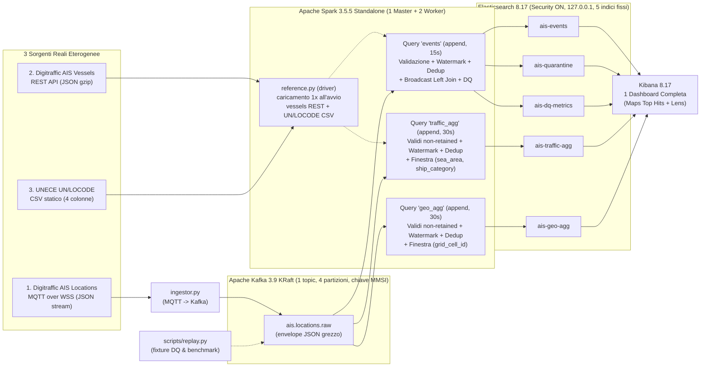

# Smart Port — Specifica Tecnica e Architetturale (Ground Truth)

> **Ruolo di questo documento:** fonte di verità tecnica unica (*Single Source of Truth*) destinata agli agenti che implementano, testano e verificano il progetto universitario **Smart Port** (corso LSDM — *Big Data Processing*).
> Smart Port è un progetto universitario didattico, **non** un sistema production-ready: applica rigorosamente **KISS** e **YAGNI**. Per la guida discorsiva e didattica allo studio si veda [`docs/project_overview.md`](../docs/project_overview.md).

---

## 1. Perimetro, Requisiti del Corso e Scelte Progettuali

### 1.1 Obiettivo
Realizzare una pipeline Big Data locale, riproducibile via **Docker Compose**, per acquisire in streaming, validare, deduplicare, integrare, aggregare in modo distribuito con **Apache Spark** e visualizzare in **Kibana** il traffico marittimo AIS nell'area finlandese/baltica.

### 1.2 Requisiti Effettivi del Corso *(Consegna Ufficiale — Vincolanti)*
1. **Scenario Big Data:** descrivere uno scenario reale in cui emerga la necessità di attività di Big Data Analysis (flusso continuo ~35 msg/s, centinaia di navi simultanee, eterogeneità di 3 sorgenti/formati, problemi reali di qualità dati).
2. **Calcolo distribuito con Apache Spark:** elaborazione distribuita su cluster multi-worker (1 Master + 2 Worker) con trasformazioni e aggregazioni temporali e spaziali.
3. **Cruscotti Kibana:** visualizzazione interattiva dei risultati in Kibana (che richiede **Elasticsearch** come backend nativo), con 1 dashboard completa esportabile/re-importabile.
4. **Processo di ingestion:** acquisizione continua da sorgente reale in streaming con disaccoppiamento tramite broker.
5. **Processo di integrazione, arricchimento e controllo qualità:** integrazione tra sorgenti eterogenee, validazione, quarantena, pulizia sentinelle, deduplicazione, gestione eventi tardivi/fuori ordine e metriche Data Quality essenziali.

### 1.3 Scelte Progettuali e Tecnologiche *(Implementazione Smart Port — KISS)*
- **3 sorgenti dati reali:** Digitraffic AIS Locations (MQTT WSS stream), Digitraffic AIS Vessels (REST JSON gzip) e UNECE UN/LOCODE (CSV statico senza coordinate). **Nessun dato meteo** (Open-Meteo escluso), **nessun calcolo Haversine**.
- **Stack Docker Compose locale:**
  - `apache/kafka:3.9.0` (KRaft single-node, **1 solo topic**: `ais.locations.raw`, 4 partizioni con chiave `mmsi`).
  - `apache/spark:3.5.5-python3` Standalone (**1 Master + 2 Worker**), puro Spark SQL per le trasformazioni nei worker (zero Python UDF).
  - `docker.elastic.co/elasticsearch/elasticsearch:8.17.4` (single-node, security ON, porte host solo su `127.0.0.1`, **5 indici fissi** con mapping espliciti; nessuna policy ILM, nessun index template, nessun indice `ais-vessels-latest`, nessuno script Painless).
  - `docker.elastic.co/kibana/kibana:8.17.4` (**1 dashboard completa**, mappa live tramite layer nativo **Top hits per entity** su `ais-events`).
  - **2 soli servizi applicativi Python (`python:3.12-slim`):** `services/ingestor/` (1 file) e `services/spark_app/` (4 file: `reference.py`, `transforms.py`, `es_sink.py`, `main.py`).
- **Caricamento sorgenti complementari:** eseguito **1 sola volta all'avvio di `spark_app`** (`unlocode_ports.csv` da disco + 1 richiesta HTTP a `/api/ais/v1/vessels` con timeout 10s e fallback a DataFrame vuoto tipizzato). Nessun refresh periodico, nessuna cache su disco, nessuno snapshot versionato.
- **Pipeline Spark in `append` mode (3 query nello stesso `SparkSession`):** tutte leggono il solo topic `ais.locations.raw` riusando funzioni condivise di `transforms.py`. La deduplicazione `dropDuplicatesWithinWatermark` e le finestre `groupBy(window(...))` sfruttano il supporto nativo Spark 3.5 (`SPARK-42376` / `SPARK-42931`) mantenendo attivi tutti i controlli di correttezza di Spark.

### 1.4 Sviluppi Successivi Non Bloccanti e Fuori Scope
- **Sviluppo successivo non bloccante:** deploy dello stesso stack `docker-compose.yml` su singola VM Linux cloud (documentato operativamente in `docs/project_overview.md` e `docs/technical_notes.md`, fuori dal percorso critico delle Fasi 0–5).
- **Esplicitamente fuori scope:** dati meteo/Open-Meteo, Haversine, Machine Learning, previsione rotte/ETA, frontend web custom, ILM/rollover/Painless, Kubernetes, Terraform/Ansible, CI/CD enterprise, garanzie *exactly-once* transazionali end-to-end.

---

## 2. Architettura di Sistema

### 2.1 Diagramma del Flusso Dati



### 2.2 Stack Tecnologico

| Componente | Immagine / Libreria | Ruolo & Motivazione |
|---|---|---|
| Message Broker | `apache/kafka:3.9.0` (KRaft single-node) | Zero ZooKeeper; 1 topic (`ais.locations.raw`), 4 partizioni per `mmsi` per parallelismo sui 2 Worker e replay semplice |
| Elaborazione | `apache/spark:3.5.5-python3` (1 Master + 2 Worker) | JAR `spark-sql-kafka-0-10_2.12:3.5.5` pre-scaricati in build; trasformazioni in puro Spark SQL |
| Storage Serving | `docker.elastic.co/elasticsearch/elasticsearch:8.17.4` | Backend nativo di Kibana; single-node, `xpack.security.enabled=true`, porte host solo `127.0.0.1`, 5 indici fissi |
| Visualizzazione | `docker.elastic.co/kibana/kibana:8.17.4` | 1 dashboard completa (Maps *Top hits per entity* + Lens) esportabile/re-importabile via Saved Objects API |
| Servizi Python | `python:3.12-slim` | `paho-mqtt>=2.0`, `kafka-python-ng` (pure Python), `requests`, `elasticsearch>=8.15,<9.0` |
| Scrittura Spark → ES | `foreachPartition` + `elasticsearch.helpers.bulk` | Evita incompatibilità di `elasticsearch-spark-30` con Spark 3.5; supporta auth ES 8 e `_id` deterministici |

### 2.3 Riferimenti Iniziali di Risorse (Mac 16 GB RAM)
Valori orientativi iniziali per eseguire lo stack su un portatile da 16 GB RAM (**non** vincoli rigidi che richiedono ottimizzazioni preventive; da validare sperimentalmente con `docker stats` in Fase 1–3):
- `kafka`: heap `256m–384m` (riferimento limit `512 MB`)
- `elasticsearch`: heap `768m` (riferimento limit `1.5 GB`)
- `kibana`: `max-old-space-size=768` (riferimento limit `1.0 GB`)
- `spark-master`: `256m` (riferimento limit `384 MB`)
- `spark-worker-1` & `spark-worker-2`: `1 core`, `768m` ciascuno, executor `640m` (riferimento limit `1.0 GB` × 2)
- `spark-app` (driver): `--driver-memory 640m`, `spark.sql.shuffle.partitions=4` (riferimento limit `1.0 GB`)
- `ingestor`: pure Python (riferimento limit `128 MB`)

### 2.4 Garanzie di Consegna, Stato Limitato e Limiti Dichiarati
- **Semantica end-to-end:** **at-least-once** con **sink Elasticsearch idempotenti** (`_id` deterministico su tutti e 5 gli indici).
- **Deduplicazione a stato limitato:** `withWatermark(..., WATERMARK_DELAY).dropDuplicatesWithinWatermark([...])` (nativo Spark 3.5) impedisce la crescita illimitata dello state store sugli executor.
- **Protezione dei record invalidi in Query `events`:** prima del watermark si calcola `is_valid`:
  - Record validi: `watermark_time = event_time`, `dedup_key = dedup_hash`.
  - Record invalidi (`is_valid == false`, dove `event_time` può essere `null`): `watermark_time = received_at`, `dedup_key = sha256(topic|partition|offset)`.
  - In questo modo nessun record malformato viene scartato silenziosamente dal watermark prima di raggiungere `ais-quarantine`.
- **Nessun doppio conteggio DQ:** solo la query `events` scrive su `ais-quarantine` e `ais-dq-metrics`; il `StreamingQueryListener` filtra esplicitamente `progress.name == "events"`. Le query `traffic_agg` e `geo_agg` scrivono solo i rispettivi indici aggregati.
- **Latenza finestre in `append` mode:** una finestra aggregata viene emessa su ES una sola volta quando il watermark supera `window_end` (latenza ~`SPARK_WINDOW_DURATION + SPARK_WATERMARK_DELAY`).
- **Limiti consapevoli:** single-node Kafka (`RF=1`) ed Elasticsearch; nessuna cancellazione automatica per età (pulizia manuale via `make reset-es`); aggiornamenti dell'anagrafica `vessels` acquisiti al riavvio di `spark-app`.

---

## 3. Sorgenti Dati e Contratto di Data Integration

### 3.1 Le 3 Sorgenti Integrate

| # | Sorgente | Organizzazione | Protocollo / Formato | Modalità di acquisizione |
|---|---|---|---|---|
| 1 | **Digitraffic AIS Locations** (`wss://meri.digitraffic.fi:443/mqtt`, topic `vessels-v2/+/location`) | Fintraffic (FI) | MQTT over WSS / JSON | Stream continuo in `ingestor.py` (~35 msg/s, CC BY 4.0, no API key) |
| 2 | **Digitraffic AIS Vessels** (`https://meri.digitraffic.fi/api/ais/v1/vessels`) | Fintraffic (FI) | REST / JSON (`Accept-Encoding: gzip`, `Digitraffic-User`) | 1 chiamata HTTP all'avvio di `spark_app` (timeout 10s, fallback a DataFrame vuoto) |
| 3 | **UNECE UN/LOCODE** (`data_static/unlocode_ports.csv`) | UNECE (ONU) | CSV statico (4 colonne, senza coordinate) | Generato e validato in Fase 0, letto da disco all'avvio di `spark_app` |

### 3.2 I 2 Pattern di Data Integration
1. **Stream-Static Join su chiave (`MMSI`):** posizioni AIS live ⋈ anagrafica `vessels` (deduplicata 1:1 per `mmsi`). **Broadcast Left Join**: nessun evento AIS valido viene perso se l'MMSI manca (`metadata_matched = false`, `ship_category = "Unknown"`).
2. **Risoluzione destinazioni (`voyage_destination_raw` ⋈ `unlocode_ports.csv`) — 3 stati conservativi (*Precision > Recall*):**
   - Schema `data_static/unlocode_ports.csv`: `locode,port_name_norm,country,is_ambiguous_name` (solo porti marittimi con `Function` contenente `1`; **nessuna colonna lat/lon**).
   - Regole in puro Spark SQL:
     1. **`EMPTY`**: `voyage_destination_raw` nullo o vuoto dopo `trim`.
     2. **`RESOLVED`**: esclusi prima i testi multi-scalo contenenti separatori (`<>`, `<->`, `->`, `/`), poi:
        - match esatto su codice UN/LOCODE a 5 caratteri normalizzato (`upper`, rimozione spazi, es. `"FI HEL"` → `"FIHEL"`) sull'intero catalogo marittimo globale; oppure
        - match esatto su `port_name_norm` solo nel bacino baltico/nord-europeo (`FI, SE, EE, LV, LT, PL, DE, DK, NO, RU, NL, BE, GB`) con `is_ambiguous_name == false`.
     3. **`UNRESOLVED`**: stringhe multi-scalo, nomi ambigui, testi operativi liberi o porti non presenti in catalogo (`dest_locode = null`, `dest_port_name = null`, `dest_country = null`).

---

## 4. Modello Dati Canonico e Mapping Elasticsearch

### 4.1 Layer Bronze (Topic Kafka `ais.locations.raw`)
Envelope JSON prodotto da `ingestor.py` con chiave Kafka = `mmsi`:
- `mmsi` (`string`, estratto dal topic MQTT `vessels-v2/<mmsi>/location`)
- `topic` (`string`, topic MQTT originale)
- `received_at` (`string`, ISO-8601 UTC)
- `is_retained` (`boolean`, da `msg.retain`)
- `raw_payload` (`string`, payload JSON grezzo inalterato, preservato anche se malformato per ispezione in `ais-quarantine`)

### 4.2 I 5 Indici Fissi Elasticsearch (Mapping Espliciti, Zero ILM/Template/Painless)

#### 1. `ais-events` (`_id = dedup_hash`)
Eventi AIS validi, deduplicati e arricchiti (~24 campi):

| Gruppo | Campi (tipo ES) | Semantica / Regola |
|---|---|---|
| **Identità & Tempo** | `@timestamp` (`date`, da `event_time` UTC), `received_at` (`date`), `mmsi` (`keyword`), `dedup_hash` (`keyword`), `latency_sec` (`float`), `is_late_event` (`boolean`), `is_retained` (`boolean`) | `dedup_hash = sha256(mmsi|event_time|round(lat,5)|round(lon,5)|sog|cog|heading|navStat)`; `latency_sec = received_at - event_time`; `is_late_event = (latency_sec > watermark_delay_sec)` |
| **Cinematica pulita** | `location` (`geo_point`), `sog` (`float`), `cog` (`float`), `heading` (`integer`), `nav_stat` (`integer`), `movement_status` (`keyword`) | Sentinelle AIS convertite in `null`: `heading == 511`, `cog >= 360`, `sog >= 102.2`, `navStat == 15` (e `rot == -128` rilevata senza persistere `rot`). `movement_status`: `stationary` (`<0.5`), `maneuvering` (`0.5–3.0`), `underway` (`>=3.0`), `unknown` (`null`) |
| **Data Quality** | `sentinel_fields` (`keyword`, array), `nav_stat_mismatch` (`boolean`) | `sentinel_fields`: nomi dei campi sentinella rilevati nell'evento grezzo (es. `["heading", "rot"]`). `nav_stat_mismatch = (sog < 0.5 and nav_stat == 0)` |
| **Spazio** | `grid_cell_id` (`keyword`), `sea_area` (`keyword`) | Griglia Lat/Lon deterministica `0.05° lat × 0.10° lon` (~5.5 × 5.5 km a 60°N) + macro-aree baltiche rettangolari in puro Spark SQL |
| **Integrazione Navi** | `metadata_matched` (`boolean`), `vessel_name` (`keyword`), `ship_category` (`keyword`), `flag_country` (`keyword`) | Da `vessels` REST (mappatura `shipType` → categoria AIS; `flag_country` da prefisso MID a 3 cifre dell'MMSI) |
| **Integrazione Porti** | `voyage_destination_raw` (`keyword`), `dest_resolution_status` (`keyword`), `dest_locode` (`keyword`), `dest_port_name` (`keyword`), `dest_country` (`keyword`) | Da `vessels` + `unlocode_ports.csv`; `dest_resolution_status` ∈ `{EMPTY, RESOLVED, UNRESOLVED}` |

#### 2. `ais-traffic-agg` (`_id = {window_start}|{sea_area}|{ship_category}`)
Query `traffic_agg` (`append` mode, solo eventi validi con `is_retained == false`, finestra tumbling configurabile `SPARK_WINDOW_DURATION`, default `2 minutes`):
- Dimensioni: `@timestamp` (`date`, `window_start`), `window_end` (`date`), `sea_area` (`keyword`), `ship_category` (`keyword`).
- Metriche: `msg_count` (`long`), `distinct_vessels_est` (`long`, `approx_count_distinct("mmsi")`), `avg_sog` (`float`, media per rilevazione), `avg_sog_moving` (`float`, media per rilevazione con `sog >= 0.5`).
- **Semantica:** `distinct_vessels_est` non è additivo tra finestre/categorie (per conteggi globali su intervalli liberi si usa `cardinality(mmsi)` su `ais-events`); `avg_sog*` sono medie **per rilevazione**, non per singola nave.

#### 3. `ais-geo-agg` (`_id = {window_start}|{grid_cell_id}`)
Query `geo_agg` (`append` mode, solo eventi validi con `is_retained == false`, finestra `SPARK_WINDOW_DURATION`):
- Dimensioni: `@timestamp` (`date`, `window_start`), `window_end` (`date`), `grid_cell_id` (`keyword`), `sea_area` (`keyword`, calcolata sul `cell_centroid` per garanzia 1:1 con la cella), `cell_centroid` (`geo_point`).
- Metriche: `msg_count` (`long`), `distinct_vessels_est` (`long`), `avg_sog` (`float`).
- **Semantica:** rappresenta la *concentrazione osservata nella cella temporale* (non sommabile tra celle, non equivalente a congestione accertata).

#### 4. `ais-dq-metrics` (`_id = batch-{batch_id}`)
Popolato **solo** dalla query `events` (1 documento per micro-batch):
- Da `foreachBatch` (1 singolo `.agg()`, tutti **conteggi interi additivi**): `@timestamp` (`date`), `batch_id` (`long`), `total_msgs` (`long`), `valid_msgs` (`long`), `invalid_msgs` (`long`), `retained_msgs` (`long`), `late_event_msgs` (`long`), `sentinel_msgs` (`long`), `vessel_matched_msgs` (`long`), `dest_resolved_msgs` (`long`).
- Da `StreamingQueryListener` (solo per `progress.name == "events"`, aggiornati sul medesimo `_id` via `es.update(..., doc_as_upsert=True)` nativo ES, zero Painless): `duplicate_dropped_msgs` (`long`, da `stateOperators[0].customMetrics.numDroppedDuplicateRows`) e `watermark_dropped_msgs` (`long`, da `stateOperators[0].numRowsDroppedByWatermark`).
- Le percentuali (`vessel_matched_msgs / valid_msgs`, `dest_resolved_msgs / valid_msgs`), la latenza p50/p95 (`percentile(latency_sec)`) e il breakdown per sentinella (`terms` su `sentinel_fields`) e stato destinazione (`terms` su `dest_resolution_status`) si calcolano nativamente in Kibana.

#### 5. `ais-quarantine` (`_id = sha256(topic|partition|offset)`)
Popolato **solo** dai record con `is_valid == false` della query `events`:
- `@timestamp` (`date`, da `received_at`), `mmsi` (`keyword`), `topic` (`keyword`), `kafka_partition` (`integer`), `kafka_offset` (`long`), `rejection_reasons` (`keyword` array ∈ `{INVALID_JSON, INVALID_MMSI, INVALID_COORDS, INVALID_TIMESTAMP}`), `raw_payload` (`text`, `index: false`).

---

## 5. Struttura del Repository

```text
smartPort/
├── AGENTS.md                         # Regole operative e principi KISS per gli agenti
├── AGENTS/
│   ├── PROJECT_SPEC.md               # Questo documento (Single Source of Truth tecnica)
│   ├── DEVELOPMENT_LOG.md            # Registro cronologico di sviluppo e verifiche
│   └── REVIEW.md                     # Template per eventuali note di studio per modulo
├── .env.example                      # Template credenziali e parametri configurabili
├── .gitignore                        # Esclude .env, data/, checkpoints/, *.jsonl (salvo fixtures)
├── docker-compose.yml                # Stack locale completo (unico ambiente obbligatorio)
├── Makefile                          # Comandi rapidi (probe, up, down, test, lint, reset-es, ...)
├── pyproject.toml                    # Dipendenze locali dev/test gestite con uv
├── README.md                         # Quickstart locale riproducibile + copione demo orale
├── digitraffic_sample.jsonl          # Campione reale preliminare MQTT
├── data_static/
│   └── unlocode_ports.csv            # Porti marittimi UNECE puliti (4 colonne, Fase 0)
├── scripts/
│   ├── probe_sources.py              # Fase 0 — Verifica sperimentale delle 3 sorgenti
│   └── replay.py                     # Fase 5 — Replay fixture DQ & benchmark 1 vs 2 Worker
├── infra/                            # Fase 1 — Bootstrap Kafka & Elasticsearch
│   ├── init-kafka.sh                 # Crea topic ais.locations.raw (4 partizioni)
│   └── init-es.sh                    # Auth kibana_system + 5 indici fissi (+ --reset)
├── services/
│   ├── ingestor/                     # Fase 1 — MQTT Digitraffic -> Kafka
│   │   ├── Dockerfile
│   │   ├── requirements.txt
│   │   └── ingestor.py
│   └── spark_app/                    # Fasi 2–3 — Reference load + Spark Streaming -> ES
│       ├── Dockerfile
│       ├── requirements.txt
│       ├── reference.py              # Caricamento 1x vessels REST + unlocode_ports.csv
│       ├── transforms.py             # Validazione, pulizia, dedup, join, spazio, aggregazioni
│       ├── es_sink.py                # Scrittura bulk ES via foreachPartition + doc_as_upsert
│       └── main.py                   # SparkSession + 3 query append + StreamingQueryListener
├── kibana/                           # Fase 4 — 1 dashboard completa esportabile/re-importabile
│   ├── dashboards/
│   ├── export.sh
│   └── import.sh
├── tests/                            # Fasi 2, 3, 5 — Suite pytest essenziale
│   ├── fixtures/dq_edge_cases.jsonl
│   ├── test_reference.py
│   └── test_spark_pipeline.py
└── docs/
    ├── project_overview.md           # Guida didattica completa per lo studente e l'esame orale
    ├── source_validation_report.md   # Fase 0 — Numeri reali misurati sulle 3 sorgenti
    └── technical_notes.md            # Fase 5 — Risultati benchmark, limiti e nota cloud VM
```

---

## 6. Roadmap Incrementale (Fasi 0 → 5)

Ogni fase produce un incremento concreto e verificabile prima di passare alla successiva.

### Fase 0 — Validazione Sperimentale delle 3 Sorgenti *(Gate Pre-Implementazione)*
- **File:** `scripts/probe_sources.py`, `data_static/unlocode_ports.csv`, `docs/source_validation_report.md`
- **Attività:**
  1. Cattura MQTT Digitraffic su `vessels-v2/+/location` (default 3 min, configurabile `--mqtt-seconds` o `--mqtt-file digitraffic_sample.jsonl`): misurare msg/s, MMSI distinti, `msg.retain`, latenza p50/p95/p99/max, eventi out-of-order, collisioni sub-secondo, duplicati esatti, sentinelle AIS e `nav_stat_mismatch`.
  2. Chiamata live `GET /api/ais/v1/vessels` (`Accept-Encoding: gzip`, `Digitraffic-User`): registrare schema reale, dimensione, MMSI distinti/duplicati e % reale di match MMSI sul campione MQTT.
  3. Estrazione UNECE UN/LOCODE: filtrare i porti marittimi (`Function` contenente `1`), calcolare `is_ambiguous_name` nello scope baltico/nord-europeo, salvare `data_static/unlocode_ports.csv` (`locode,port_name_norm,country,is_ambiguous_name`, **senza coordinate**) e misurare la distribuzione dei 3 stati (`EMPTY`, `RESOLVED`, `UNRESOLVED`) sulle destinazioni reali di `/api/ais/v1/vessels`.
- **Definition of Done:**
  - [x] `docs/source_validation_report.md` compilato con numeri reali misurati per tutte e 3 le sorgenti (cattura live >= 3 min).
  - [x] `data_static/unlocode_ports.csv` pulito, validato e salvato nel repository.
  - [x] Soglia `SPARK_WATERMARK_DELAY`, confini `sea_area` e regole di pulizia destinazioni calibrati sui dati osservati e annotati nel report.

### Fase 1 — Infrastruttura Docker Compose & Ingestion Live
- **File:** `docker-compose.yml`, `.env.example`, `Makefile`, `infra/init-kafka.sh`, `infra/init-es.sh`, `services/ingestor/{Dockerfile,requirements.txt,ingestor.py}`
- **Dipendenze:** Fase 0.
- **Contratti:**
  - Rete Docker `smartport-net`, volumi persistenti (`kafka_data`, `es_data`, `kibana_data`, `spark_checkpoints`); tutte le porte host legate esclusivamente a `127.0.0.1` (`5601`, `8080`, `9200`).
  - `init-kafka.sh` (one-shot idempotente): crea il solo topic `ais.locations.raw` (4 partizioni, `RF=1`, retention 24h / 1 GB).
  - `init-es.sh` (one-shot idempotente): imposta password `kibana_system` e crea i **5 indici fissi** con mapping espliciti (`ais-events`, `ais-traffic-agg`, `ais-geo-agg`, `ais-dq-metrics`, `ais-quarantine`). Supporta `--reset` (solo manuale via `make reset-es`) per cancellare `ais-*` e ricreare gli indici vuoti.
  - `ingestor.py` (~90 righe): connessione WSS a Digitraffic (`paho-mqtt>=2.0`, `CallbackAPIVersion.VERSION2`, backoff nativo `reconnect_delay_set`), sottoscrizione solo `vessels-v2/+/location`, pubblicazione su `ais.locations.raw` via `kafka-python-ng` (chiave `mmsi`, `acks='all'`, `gzip`), envelope Sez. 4.1 senza scartare JSON malformati, log sintetico ogni 30s.
- **Definition of Done:**
  - [ ] `docker compose up -d` su ambiente pulito porta tutti i servizi `healthy` senza interventi manuali.
  - [ ] Spark Master UI (`http://127.0.0.1:8080`) mostra **2 Worker `ALIVE`**.
  - [ ] Elasticsearch rifiuta richieste anonime, risponde con credenziali da `.env` e contiene i 5 indici fissi; `make reset-es` testato su ambiente vuoto.
  - [ ] Kibana (`http://127.0.0.1:5601`) accessibile con login `elastic`.
  - [ ] `ingestor` popola `ais.locations.raw` sulle 4 partizioni e si riconnette automaticamente dopo `docker compose restart kafka`.

### Fase 2 — Spark Streaming: Validazione, Deduplicazione, Integrazione & DQ *(Vertical Slice)*
- **File:** `services/spark_app/{Dockerfile,requirements.txt,reference.py,transforms.py,es_sink.py,main.py}`, `tests/test_reference.py`, `tests/test_spark_pipeline.py`
- **Dipendenze:** Fase 1.
- **Contratti:**
  - **`reference.py`:** legge `data_static/unlocode_ports.csv` ed esegue 1 chiamata HTTP a `/api/ais/v1/vessels` all'avvio (timeout 10s, dedup 1:1 su `mmsi`, fallback a DataFrame vuoto tipizzato con log warning se API non raggiungibile).
  - **`transforms.py` (puro Spark SQL, zero Python UDF nei worker):** parsing/validazione Bronze, quarantena (`rejection_reasons`), sentinelle AIS e `sentinel_fields`, `dedup_hash`, `movement_status`, `nav_stat_mismatch`, griglia Lat/Lon `0.05° × 0.10°`, `sea_area`, risoluzione destinazioni 3 stati, 2 Broadcast Left Join garantendo `count_out == count_in`, aggregazione DQ del batch in 1 singolo `.agg()`.
  - **`es_sink.py`:** `foreachPartition` + `elasticsearch.helpers.bulk` con `_id` deterministico + helper `update_dq_progress` con `doc_as_upsert=True` (zero Painless, zero routing per data).
  - **`main.py`:** `SparkSession`, caricamento `reference.py`, avvio Query `events` (`append` mode, trigger `15s`, checkpoint `/checkpoints/events`, `withWatermark("watermark_time", ...).dropDuplicatesWithinWatermark(["dedup_key"])`) e `StreamingQueryListener` filtrato su `progress.name == "events"`.
  - **Gate anticipato Spark 3.5.5:** includere già in `tests/test_spark_pipeline.py` un test PySpark 3.5.5 reale che verifichi la concatenazione `withWatermark` + `dropDuplicatesWithinWatermark` + `groupBy(window)` in `append` mode con `checkCorrectness` attivo (default `true`).
- **Definition of Done:**
  - [ ] `uv run pytest` (incluso test di compatibilità Spark 3.5.5 per deduplicazione + finestra in `append` mode) passa al 100%.
  - [ ] Pipeline live sui 2 Worker popola `ais-events`, `ais-quarantine` e `ais-dq-metrics` con 0 errori e senza doppi conteggi.
  - [ ] Consumo RAM misurato con `docker stats` compatibile con macchina da 16 GB.

### Fase 3 — Spark Streaming: Aggregazioni Temporali & Spaziali
- **File:** `services/spark_app/{transforms.py,main.py}`, `tests/test_spark_pipeline.py`
- **Dipendenze:** Fase 2.
- **Contratti:**
  - Aggiunta delle query `traffic_agg` (checkpoint `/checkpoints/traffic-agg`, trigger `30s`) e `geo_agg` (checkpoint `/checkpoints/geo-agg`, trigger `30s`) nello stesso `SparkSession`, entrambe in `append` mode sullo stream validato non-retained da `ais.locations.raw`:
    - `withWatermark("event_time", WATERMARK_DELAY).dropDuplicatesWithinWatermark(["dedup_hash"])` → `groupBy(window("event_time", WINDOW_DURATION), ...)` → scrittura idempotente su `ais-traffic-agg` e `ais-geo-agg`.
  - **Vietato** disabilitare `spark.sql.streaming.statefulOperator.checkCorrectness.enabled` o rimuovere la deduplicazione prima delle aggregazioni.
- **Definition of Done:**
  - [ ] Test PySpark 3.5.5 reale su `events`, `traffic_agg` e `geo_agg` (inclusi duplicati esatti, eventi tardivi e collisioni sub-secondo) verdi al 100%.
  - [ ] Tutti e 5 gli indici Elasticsearch popolati live con task distribuiti visibili nella Spark UI sui 2 Worker.
  - [ ] `docker compose restart spark-app` riprende dai checkpoint senza duplicare documenti su Elasticsearch.

### Fase 4 — Visualizzazione Kibana *(1 Dashboard Completa)*
- **File:** `kibana/dashboards/*.ndjson`, `kibana/export.sh`, `kibana/import.sh`
- **Dipendenze:** Fase 3.
- **Contratto della Dashboard Unica (`smartport_dashboard`):**
  Organizzata in 3 blocchi visivi chiari dentro una sola dashboard con auto-refresh (`30s`):
  1. **Mappa & Panoramica Live:** mappa Kibana Maps con layer nativo **Top hits per entity** (`entity = mmsi`, 1 doc più recente su `ais-events`, colore per `ship_category`, icona orientata per `cog`/`heading`, tooltip con nave/stato/destinazione); KPI globali su `ais-events` (messaggi totali, `cardinality(mmsi)` navi distinte, filtri `sea_area`, `ship_category`, `movement_status`, `dest_resolution_status`).
  2. **Analisi Traffico & Concentrazione Spaziale:** trend temporale messaggi e `distinct_vessels_est` per finestra (`ais-traffic-agg`, con nota esplicita di non-additività), velocità media `avg_sog_moving` (*per rilevazione*), distribuzione `ship_category` e top destinazioni risolte (`dest_port_name` su `ais-events`), mappa di concentrazione spaziale su `ais-geo-agg` (`cell_centroid` + `distinct_vessels_est`).
  3. **Data Quality & Quarantena:** KPI e trend da `ais-dq-metrics` (`valid_msgs`, `invalid_msgs`, `duplicate_dropped_msgs`, `watermark_dropped_msgs`, copertura `vessel_matched_msgs / valid_msgs` e `dest_resolved_msgs / valid_msgs`), breakdown nativo su `ais-events` (`sentinel_fields`, `dest_resolution_status`, `is_late_event`, latenza p50/p95) e tabella ispezionabile di `ais-quarantine` filtrabile per `rejection_reasons`.
- **Definition of Done:**
  - [ ] La dashboard si aggiorna automaticamente sui dati live.
  - [ ] `make export-kibana` esporta Data Views e dashboard in `kibana/dashboards/`.
  - [ ] Su Kibana vuoto, `make import-kibana` ricrea Data Views e dashboard senza errori.

### Fase 5 — Validazione DQ End-to-End, Benchmark & Consegna Finale
- **File:** `scripts/replay.py`, `tests/fixtures/dq_edge_cases.jsonl`, `docs/technical_notes.md`, `README.md`
- **Dipendenze:** Fase 4.
- **Contratti:**
  - **Replay DQ (`scripts/replay.py --mode fixture`):** invia `tests/fixtures/dq_edge_cases.jsonl` su `ais.locations.raw` (con timestamp traslati vicino a `now()` per non falsare il watermark; copre JSON malformato, MMSI/coords/timestamp invalidi, sentinelle AIS, duplicato esatto, collisione sub-secondo, evento tardivo oltre watermark, `is_retained=true`, MMSI sconosciuto, destinazioni `'FIHEL'`, `'FI HEL'`, `'FIHEL<>FIMHQ'`, `'KOTKA TRAFFIC AREA'`, nome omonimo) e verifica gli esiti attesi sui 5 indici ES.
  - **Benchmark 1 vs 2 Worker (`scripts/replay.py --mode benchmark`):** eseguito su stack pulito (`make reset-es` + pulizia checkpoint + ingestor fermo), rigioca campioni AIS reali con time-shift monotono e cloning MMSI a 9 cifre su moltiplicatori iniziali orientativi (`1x`, `5x`, `10x`, adattabili alla soglia reale di saturazione osservata), confrontando **1 Spark Worker (1 core) vs 2 Spark Worker (2 core)** su `inputRowsPerSecond`, `processedRowsPerSecond`, `batchDurationMs` e `docker stats`.
  - **Documentazione finale:** `README.md` con guida completa di avvio/arresto/reset e copione demo orale (< 3 min per creare un grafico Lens live in Kibana); `docs/technical_notes.md` con risultati reali misurati del benchmark (distinguendo *parallelismo intra-nodo* vs *scalabilità multi-host*), eventuali scostamenti emersi in implementazione e nota operativa per deploy su singola VM cloud Linux.
- **Definition of Done:**
  - [ ] `uv run pytest` e `uv run ruff check .` verdi al 100%.
  - [ ] Fixture DQ verificate end-to-end sui 5 indici ES.
  - [ ] Test di restart (`spark-app`, `kafka`, `elasticsearch`) superati senza duplicazioni su ES.
  - [ ] Benchmark 1 vs 2 Worker registrato con numeri reali in `docs/technical_notes.md`.
  - [ ] Stack avviabile da zero seguendo solo `README.md`.

---

## 7. Decisioni Aperte (da Calibrare Sperimentalmente)

1. **Soglia Watermark (`SPARK_WATERMARK_DELAY`):** valore iniziale `1 minute`, da calibrare sui percentili reali (p99 latenza e out-of-order) misurati in **Fase 0**.
2. **Durata finestra (`SPARK_WINDOW_DURATION`):** valore iniziale `2 minutes` (per demo reattiva in `append` mode), configurabile da `.env` (es. `5 minutes`) dopo le prime prove in **Fase 3**.
3. **Confini delle `sea_area` baltiche e separatori destinazioni UN/LOCODE:** tarati sui dati reali in **Fase 0**.
4. **Compatibilità reale Spark 3.5.5 (`dropDuplicatesWithinWatermark` + `groupBy(window)` in `append` mode con `checkCorrectness=true`):** verificata subito con test PySpark reale in **Fase 2** (se emergesse un blocco imprevisto di Spark 3.5.5, fermarsi e discutere con l'utente senza mai disabilitare i controlli di correttezza né rimuovere la deduplicazione).
5. **Budget RAM container e moltiplicatori benchmark (`1x`, `5x`, `10x`):** riferimenti iniziali da aggiustare solo in base a misure reali (`docker stats` in Fase 1–3 e tempi batch in Fase 5).

---

## 8. Invarianti Architetturali (Regole Vincolanti)

1. **Correttezza Stateful Spark 3.5:** mantenere sempre attivo `spark.sql.streaming.statefulOperator.checkCorrectness.enabled` (default `true`) e mantenere la deduplicazione `dropDuplicatesWithinWatermark` su tutte le query (`events`, `traffic_agg`, `geo_agg`).
2. **Nessuna perdita sulle collisioni sub-secondo:** deduplicare sempre su `dedup_hash` completo, mai sul solo `(mmsi, event_time)`.
3. **Quarantena garantita e zero doppi conteggi DQ:** in Query `events` i record invalidi usano `watermark_time = received_at` e `dedup_key = sha256(topic|partition|offset)` per non essere scartati dal watermark; solo Query `events` scrive su `ais-quarantine` e `ais-dq-metrics`.
4. **Zero Python UDF nei worker Spark** per validazione, pulizia, spazio, risoluzione destinazioni e join (Python nei worker solo in `foreachPartition` per il bulk ES).
5. **Elasticsearch semplice e idempotente:** 5 indici fissi con mapping espliciti e `_id` deterministici; nessun ILM, nessun index template, nessun indice `ais-vessels-latest`, nessuno script Painless.
6. **Spark Shuffle Tuning:** `spark.sql.shuffle.partitions` sempre letto da `.env` (default `4` in locale, mai lasciare il default `200`).
7. **Precision > Recall sulle destinazioni:** stringhe multi-scalo o ambigue restano `UNRESOLVED`, mai indovinate.
8. **Onestà semantica delle metriche:** distinguere messaggi vs navi distinte, non-additività di `distinct_vessels_est`, media per rilevazione `avg_sog*` vs singola nave, concentrazione vs congestione, parallelismo intra-nodo vs scalabilità multi-host, semantica *at-least-once* con sink idempotenti.
9. **Sicurezza base by default:** nessuna credenziale su Git (`.env` ignorato, `.env.example` con placeholder); security Elasticsearch sempre attiva; porte host legate solo a `127.0.0.1`; pulizia indici (`make reset-es`) solo manuale.
10. **Separazione test/live:** fixture DQ e benchmark non devono inquinare dati live né falsare il watermark con timestamp vecchi non traslati.
