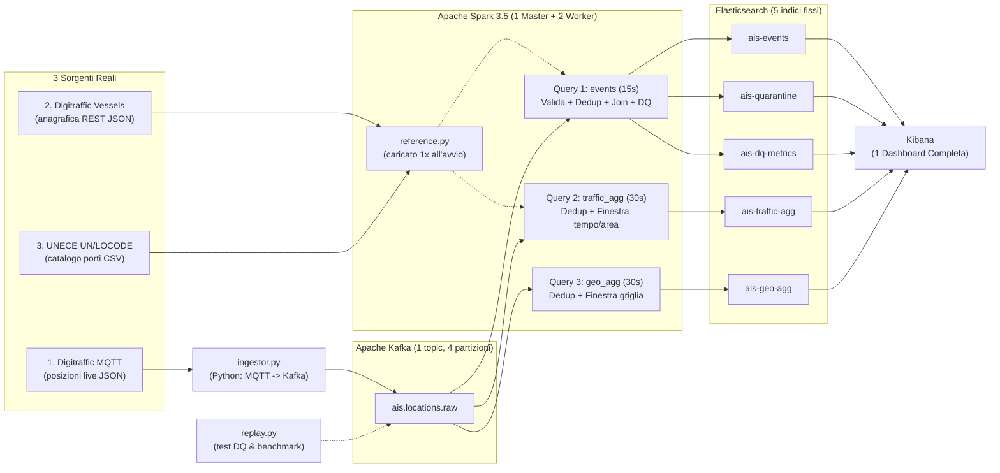

# Smart Port — Guida Didattica all'Architettura e alle Tecnologie

> **A chi è destinata questa guida:** a chi sta imparando da zero le tecnologie di **Big Data Processing** usate nel progetto (MQTT, Apache Kafka, Apache Spark, Elasticsearch, Kibana e Docker Compose) e vuole comprendere a fondo ogni scelta per **studiare il progetto e difenderlo all'esame orale**.
> Per i contratti tecnici operativi (mapping esatti, schemi, regole di implementazione e Definition of Done per gli agenti) la fonte di verità resta [`AGENTS/PROJECT_SPEC.md`](../AGENTS/PROJECT_SPEC.md).

---

## 1. Perché Smart Port è uno scenario Big Data (e cosa richiede il corso)

La consegna ufficiale del corso *LSDM – Big Data Processing* chiede 5 cose concrete:
1. **Descrivere uno scenario** in cui emerga la necessità di attività di *Big Data Analysis*.
2. **Calcolo distribuito** usando **Apache Spark**.
3. **Costruzione di cruscotti** in **Kibana**.
4. **Definire il processo di ingestion** dei dati.
5. **Definire il processo di integrazione, arricchimento e controllo qualità** dei dati.

### Perché il traffico marittimo AIS nell'area baltica è un caso ideale
Le navi trasmettono continuamente la propria posizione, velocità e rotta tramite il sistema **AIS** (*Automatic Identification System*). L'autorità marittima finlandese (**Fintraffic / Digitraffic**) pubblica in tempo reale questo flusso in formato aperto, senza bisogno di chiavi API.

Già da un campione reale di soli 30 secondi (`digitraffic_sample.jsonl`), emergono tutte le classiche "V" dei Big Data:
- **Velocity (Velocità / Flusso continuo):** ~35 messaggi al secondo (~3 milioni di posizioni al giorno su una singola area regionale), che arrivano senza sosta da centinaia di navi contemporaneamente (342 MMSI distinti in 30 secondi). Non si può analizzare tutto scaricando un CSV a mano.
- **Variety (Varietà / Eterogeneità):** i soli punti GPS dicono poco. Per capire *che tipo di nave* si muove e *verso quale porto* sta andando, dobbiamo combinare **3 sorgenti diverse** per formato, protocollo e organizzazione:
  1. **Digitraffic AIS Locations** (Fintraffic): stream continuo **MQTT over WebSocket** in JSON (solo posizione, velocità, rotta e codice numerico `MMSI`).
  2. **Digitraffic AIS Vessels** (Fintraffic): API **REST HTTP** (JSON compresso gzip) con l'anagrafica delle navi (nome, tipo nave, destinazione dichiarata dal comandante).
  3. **UNECE UN/LOCODE** (Nazioni Unite): tabella **CSV** statica che cataloga i codici ufficiali e i nomi dei porti marittimi.
- **Veracity (Qualità reale dei dati):** i dati reali sono sporchi. Nel campione Digitraffic abbiamo osservato direttamente:
  - **Valori sentinella AIS:** invece di scrivere `null`, il protocollo AIS invia numeri fittizi come `heading = 511` ("bussola non disponibile"), `rot = -128`, `cog >= 360`, `sog >= 102.2`, `navStat = 15`. Se fai una media della velocità o della rotta senza pulirli, ottieni risultati sbagliati.
  - **Incoerenze operative:** circa l'80% delle navi ferme (`sog < 0.5` nodi) continua a trasmettere `navStat = 0` ("in navigazione a motore") perché l'equipaggio non aggiorna lo stato in plancia.
  - **Destinazioni scritte a mano:** il campo `destination` inserito dall'equipaggio contiene codici corretti (`FIHEL`), codici con spazi (`FI HEL`), tratte multi-scalo (`FIHEL<>FIMHQ`), aree generiche (`KOTKA TRAFFIC AREA`) o campi vuoti.
  - **Collisioni sub-secondo e messaggi fuori ordine:** il timestamp AIS ha risoluzione al secondo; una stessa nave può inviare due messaggi diversi nello stesso secondo, oppure pacchetti radio possono arrivare in ritardo rispetto all'orario di generazione.

---

## 2. Architettura Complessiva e Viaggio di un Messaggio AIS

Smart Port è progettato secondo i principi **KISS** (*Keep It Simple, Stupid*) e **YAGNI** (*You Aren't Gonna Need It*): è un progetto universitario completo e corretto, **non** un sistema aziendale production-ready. Ogni componente ha un ruolo preciso e facile da spiegare.



### Il viaggio passo-passo di un messaggio reale

Seguiamo un messaggio reale tratto da `digitraffic_sample.jsonl`:

**1. Arrivo su MQTT (`ingestor.py`)**
Digitraffic pubblica sul topic `vessels-v2/219115000/location`:
```json
{"cog": 60.8, "heading": 60, "lat": 60.10915, "lon": 26.2257, "navStat": 0, "rot": 0, "sog": 15.6, "time": 1795551440}
```
`ingestor.py` **non trasforma né scarta il dato**: estrae `mmsi = "219115000"` dal nome del topic, aggiunge il timestamp di ricezione (`received_at`) e il flag MQTT `is_retained`, impacchetta tutto in una busta JSON (*envelope*) e la spedisce su Kafka (`ais.locations.raw`) usando `mmsi` come chiave di partizionamento.

**2. Transito in Apache Kafka (`ais.locations.raw`)**
Kafka calcola `hash("219115000") % 4` e accoda il messaggio in una delle **4 partizioni** del topic. In questo modo tutti i messaggi della stessa nave vanno nella stessa partizione (mantenendo l'ordine di arrivo per nave) e i **2 Worker Spark** possono leggere 2 partizioni ciascuno in parallelo.

**3. Elaborazione distribuita in Apache Spark (`spark_app`)**
All'avvio, il driver Spark ha già caricato una sola volta in memoria le tabelle leggere `vessels` (da REST) e `unlocode_ports.csv` (da disco), inviandone una copia a entrambi i Worker (**Broadcast Join**). Ora le 3 query streaming leggono in micro-batch da `ais.locations.raw`:
- **Query 1 (`events`, ogni 15s):**
  - Valida il JSON, controlla che l'MMSI abbia 9 cifre, che `lat`/`lon` siano coordinate geografiche valide e che `time` sia valido.
  - Calcola `dedup_hash` (hash SHA-256 di identità + timestamp + cinematica) ed elimina eventuali duplicati esatti entro il watermark (`dropDuplicatesWithinWatermark`).
  - Pulisce le sentinelle (es. se `heading == 511` diventa `null` e aggiunge `"heading"` all'array `sentinel_fields`).
  - Calcola `movement_status = "underway"` (perché `sog = 15.6 >= 3.0`), `grid_cell_id` (cella `0.05° × 0.10°`) e `sea_area` (`"Gulf of Finland"`).
  - Fa **Left Join** con `vessels` tramite `mmsi` (ottiene nome nave, `ship_category`, `flag_country`, `voyage_destination_raw`) e **Left Join** con `unlocode_ports` sulla destinazione normalizzata (es. `"FI HEL"` → `dest_resolution_status = "RESOLVED"`, `dest_locode = "FIHEL"`, `dest_port_name = "Helsinki"`).
  - Scrive il documento pulito in `ais-events` (con `_id = dedup_hash`) e aggiorna i contatori di qualità del batch in `ais-dq-metrics`.
- **Cosa succede invece a un messaggio rotto?** Immaginiamo arrivi `{"lat": 999, "lon": 24.5, "time": null}`: viene marcato `is_valid = false` con `rejection_reasons = ["INVALID_COORDS", "INVALID_TIMESTAMP"]`. Per evitare che il watermark lo scarti (avendo `event_time = null`), usa `received_at` come timestamp tecnico e finisce intatto in `ais-quarantine` insieme al `raw_payload` originale, senza mai contaminare `ais-events` né le aggregazioni.
- **Query 2 (`traffic_agg`, ogni 30s) e Query 3 (`geo_agg`, ogni 30s):**
  - Leggono i messaggi validi non-retained da `ais.locations.raw`, deduplicano con `dropDuplicatesWithinWatermark` e raggruppano per finestra temporale (default `2 minutes`, configurabile a `5 minutes`):
    - `traffic_agg` calcola messaggi, navi distinte stimate (`approx_count_distinct`) e velocità media per `(finestra, sea_area, ship_category)` → scrive su `ais-traffic-agg`.
    - `geo_agg` calcola messaggi, navi distinte stimate e velocità media per `(finestra, grid_cell_id)` → scrive su `ais-geo-agg`.

**4. Persistenza in Elasticsearch e Visualizzazione in Kibana**
Elasticsearch indicizza i documenti nei 5 indici fissi. Kibana interroga Elasticsearch e aggiorna la dashboard unica ogni 30 secondi: mostra ogni nave nella sua ultima posizione sulla mappa, i grafici del traffico nel tempo, la heatmap spaziale e lo stato della qualità dei dati.

---

## 3. Le Tecnologie Spiegate da Zero

### 3.1 MQTT e `ingestor.py`
- **Cos'è MQTT:** è un protocollo leggero di messaggistica *publish/subscribe* nato per l'IoT e i sensori. Un server centrale (il *broker*, qui `meri.digitraffic.fi`) riceve messaggi su canali chiamati *topic* (es. `vessels-v2/219115000/location`) e li inoltra istantaneamente a tutti i client sottoscritti (anche tramite wildcard `+`, come `vessels-v2/+/location`).
- **Flag `retain`:** quando ti connetti a un broker MQTT, questo ti spedisce subito l'ultimo messaggio salvato di ogni nave con il flag `msg.retain = true` per darti uno "stato iniziale". Noi salviamo `is_retained` nel documento così possiamo tracciarlo in Data Quality ed escluderlo dalle aggregazioni temporali (altrimenti all'avvio vedresti un picco finto di migliaia di messaggi vecchi).
- **Perché serve `ingestor.py`:** Apache Spark non ha un connettore MQTT nativo. Un piccolo script Python (~90 righe con `paho-mqtt` e `kafka-python-ng`) fa da ponte puro: riceve da MQTT over WebSocket sicuro (`WSS`, porta 443) e scrive su Kafka. Non fa pulizia né logica di business: quella spetta tutta a Spark.
- **Alternative valutate:** *Kafka Connect con plugin MQTT* (richiede un container Java in più, configurazioni JSON verbose e plugin di terze parti); *connessione socket diretta a Spark* (la documentazione Spark sconsiglia i socket perché non gestiscono fault-tolerance, replay né partizionamento).

### 3.2 Apache Kafka (modalità KRaft)
- **Cos'è:** è un *distributed commit log* (un registro sequenziale persistente e partizionato di messaggi) usato come **message broker** tra chi produce dati (*Producer*, qui `ingestor.py` e `replay.py`) e chi li consuma (*Consumer*, qui Spark).
- **Concetti chiave:**
  - **Topic:** il "canale" logico in cui finiscono i messaggi. Nel nostro progetto ne basta **uno solo**: `ais.locations.raw`.
  - **Partizioni:** un topic è diviso fisicamente in più code parallele (qui **4 partizioni**). Ogni messaggio con la stessa chiave (`mmsi`) finisce nella stessa partizione. Le partizioni sono l'unità di parallelismo: con 4 partizioni e 2 Worker Spark, ogni Worker legge 2 partizioni in parallelo.
  - **Offset:** il numero progressivo univoco di ogni messaggio dentro una partizione (0, 1, 2, ...). Spark salva nei *checkpoint* fino a quale offset ha già elaborato: se Spark si riavvia, riparte esattamente dal messaggio successivo senza rileggere tutto dall'inizio.
  - **KRaft:** nelle versioni recenti di Kafka (3.x) Kafka gestisce i propri metadati da solo senza bisogno di **Apache ZooKeeper**. Significa un container in meno, meno RAM e avvio più semplice.
- **Perché è necessario:**
  1. **Disaccoppiamento:** se Spark si ferma o rallenta per 5 minuti, `ingestor.py` continua a salvare i messaggi su Kafka senza perderli.
  2. **Parallelismo:** permette ai 2 Worker Spark di dividersi il lavoro in modo naturale.
  3. **Riproducibilità:** `scripts/replay.py` può iniettare gli stessi messaggi di test o benchmark dentro `ais.locations.raw` esattamente come farebbe il flusso reale.
- **Alternative valutate:**
  - *Due topic Kafka (`ais.locations.raw` + `ais.locations.enriched`)*: l'architettura precedente usava un secondo topic intermedio tra pulizia e aggregazioni. Con Spark 3.5 non è necessario: tenere 1 solo topic elimina codice, serializzazione intermedia e casi limite di inconsistenza tra i due stadi.
  - *File JSON su disco condiviso al posto di Kafka*: fragile sulla concorrenza lettura/scrittura, non insegna lo standard reale di ingestion streaming.

### 3.3 Apache Spark 3.5 e Structured Streaming
- **Cos'è:** è il motore di **calcolo distribuito** richiesto esplicitamente dal corso. Invece di elaborare i dati in un solo processo Python, Spark divide il lavoro in *task* paralleli eseguiti su più processi (*Executor*) ospitati dai nodi *Worker*.
- **Architettura del cluster locale:**
  - **Spark Master** (`:8080`): il coordinatore delle risorse. Mostra la Web UI dove si vedono i Worker attivi (`ALIVE`) e i job in esecuzione.
  - **2 Spark Worker** (`spark-worker-1`, `spark-worker-2`, 1 core ciascuno): i nodi che eseguono fisicamente i calcoli (gli *Executor*). Avere 2 Worker permette di dimostrare concretamente l'esecuzione distribuita e fare il benchmark 1 vs 2 Worker.
  - **Driver (`spark-app`)**: il processo che esegue `main.py`, costruisce il piano di esecuzione delle query e assegna i task ai 2 Worker.
- **Come funziona Structured Streaming (Micro-Batch):**
  Invece di processare un singolo evento alla volta con codice imperativo complesso, Spark Structured Streaming tratta lo stream continuo come una **tabella che cresce all'infinito**. Ogni `15` o `30` secondi (*trigger*) legge i nuovi offset da Kafka come un piccolo DataFrame (*micro-batch*) e applica normali trasformazioni **Spark SQL** (`select`, `filter`, `join`, `groupBy`).
- **Concetti teorici fondamentali da sapere all'orale:**
  - **Spark SQL puro vs Python UDF:** le trasformazioni espresse con le funzioni native di `pyspark.sql.functions` vengono compilate ed eseguite direttamente nella JVM (Catalyst Optimizer + Tungsten) sui Worker, senza serializzare ogni riga verso Python. Per questo non usiamo mai Python UDF nei Worker (Python gira nei Worker solo in `foreachPartition` per fare le chiamate HTTP bulk verso Elasticsearch).
  - **Broadcast Left Join:** le tabelle `vessels` (~qualche migliaio di righe) e `unlocode_ports` sono piccole rispetto allo stream continuo. Con `F.broadcast(df)`, il Driver le invia una volta sola nella RAM di ogni Worker: il join avviene localmente in memoria su ciascun Worker senza spostare lo stream in rete (*shuffle*). Usiamo un **Left Join** perché un'anagrafica mancante non deve mai far sparire una posizione GPS valida.
  - **Event Time vs Processing Time:** *Event Time* (`event_time`) è l'istante in cui la nave ha generato la posizione; *Processing Time* (`received_at`) è quando il nostro sistema l'ha ricevuta. Le finestre temporali vanno fatte su *Event Time* per essere fedeli alla realtà fisica anche se la rete ritarda un pacchetto.
  - **Watermark (`withWatermark`):** se un evento può arrivare in ritardo, per quanto tempo Spark deve tenere in RAM lo stato delle finestre aperte e dei duplicati già visti? Se lo tenesse per sempre, la RAM si esaurirebbe (*OOM*). Il **Watermark** dice a Spark: *"tieni in memoria lo stato per un ritardo massimo `D` (es. 1 minuto) dietro al massimo `event_time` osservato finora; tutto ciò che è più vecchio di `max_event_time - D` è considerato chiuso e può essere liberato dalla RAM"*. La soglia `D` va calibrata in Fase 0 sui ritardi reali misurati su Digitraffic.
  - **Deduplicazione a stato limitato (`dropDuplicatesWithinWatermark`):** introdotta in Spark 3.5 (`SPARK-42931`), scarta i record con la stessa chiave (`dedup_hash`) arrivati entro la soglia del watermark e ripulisce automaticamente lo stato vecchio. Deduplichiamo su `dedup_hash` (che include posizione, velocità, rotta e stato) e **non** sul solo `(mmsi, event_time)`, perché una nave può inviare due posizioni realmente diverse nello stesso secondo (collisioni sub-secondo osservate nel campione reale).
  - **Output Mode (`append` vs `update`) e concatenazione stateful in Spark 3.5:**
    - In `update` mode Spark riemette una riga aggregata a ogni micro-batch finché la finestra è aperta.
    - In **`append` mode** Spark emette ciascuna finestra aggregata **una sola volta, solo quando è definitivamente chiusa** (`watermark > window_end`). Spark 3.5 (`SPARK-42376` + `SPARK-42931`) supporta la propagazione del watermark tra `dropDuplicatesWithinWatermark` e `groupBy(window)` in `append` mode mantenendo attivi tutti i controlli di correttezza. La compatibilità reale su `apache/spark:3.5.5-python3` sarà verificata subito con un test PySpark reale in Fase 2.
  - **Shuffle Partitions (`spark.sql.shuffle.partitions=4`):** per operazioni come deduplicazione e `groupBy`, Spark ridistribuisce i dati per chiave (*shuffle*). Il default di Spark è `200` partizioni (pensato per cluster da decine di macchine!): in locale creerebbe 200 mini-task a ogni micro-batch rallentando tutto. Impostarlo a `4` (allineato alle 4 partizioni Kafka e ai 2 core) rende i batch rapidi e leggeri.
  - **Checkpoint:** cartella persistente su volume Docker dove Spark salva gli offset Kafka già letti e lo stato corrente degli operatori stateful, così dopo un riavvio riprende dal punto esatto senza ripartire da zero.

### 3.4 Elasticsearch 8.17
- **Cos'è:** è un motore di ricerca e analisi distribuito orientato ai documenti JSON, ed è il **backend nativo di Kibana** (quindi la sua adozione discende direttamente dal requisito Kibana del corso).
- **Concetti chiave:**
  - **Indice:** l'equivalente di una tabella in un database relazionale (noi ne creiamo **5 fissi**, uno per ciascun ruolo chiaro: `ais-events`, `ais-traffic-agg`, `ais-geo-agg`, `ais-dq-metrics`, `ais-quarantine`).
  - **Mapping esplicito:** lo schema dei tipi di campo dichiarato alla creazione dell'indice (`init-es.sh`). È fondamentale dichiararlo esplicitamente per almeno due motivi:
    1. Le coordinate geografiche devono essere mappate come **`geo_point`**, altrimenti Kibana Maps non può disegnarle sulla mappa.
    2. I campi su cui facciamo filtri e raggruppamenti (`mmsi`, `ship_category`, `sea_area`, `dest_port_name`) devono essere **`keyword`** (valore esatto), non `text` (che spezzerebbe `"Gulf of Finland"` in tre parole separate!). Al contrario, `raw_payload` in quarantena ha `index: false`: viene salvato per mostrarlo in tabella senza sprecare RAM per indicizzarne le parole.
  - **Idempotenza tramite `_id` deterministico:** ogni documento su Elasticsearch ha un identificativo `_id`. Se lasciamo a ES il compito di generare un `_id` casuale, un retry di un micro-batch Spark creerebbe un documento duplicato. Calcolando un `_id` deterministico dai dati (es. `dedup_hash` per gli eventi, `{window_start}|{sea_area}|{ship_category}` per le aggregazioni, `batch-{batch_id}` per le metriche DQ), riscrivere lo stesso documento sovrascrive semplicemente sé stesso senza mai creare duplicati.
  - **Scrittura via `foreachPartition` + `elasticsearch.helpers.bulk`:** invece di usare il vecchio connettore Scala `elasticsearch-spark-30` (spesso incompatibile con Spark 3.5 e auth ES 8), ogni partizione del micro-batch apre 1 client Python `elasticsearch` e invia i documenti in blocco (*bulk*). È codice lineare (~50 righe), affidabile e facilissimo da debuggare.
- **Cosa abbiamo scelto di NON usare (KISS/YAGNI):**
  - **Nessuna policy ILM, nessun rollover e nessun index template giornaliero (`YYYY.MM.DD`):** meccanismi da sistemi 24/7 in produzione. Per un progetto universitario bastano 5 indici fissi e un comando manuale esplicito (`make reset-es`) per ripartire da zero quando serve.
  - **Nessun indice `ais-vessels-latest` e nessuno script Painless:** servivano solo a mantenere l'ultima posizione di ogni nave; Kibana Maps lo fa già nativamente!
- **Sicurezza minima:** manteniamo attiva l'autenticazione nativa di Elasticsearch (`xpack.security.enabled=true`), con password lette da `.env` (mai committate su Git) e porte esposte solo su `127.0.0.1` (accessibili solo dal tuo computer).

### 3.5 Kibana 8.17
- **Cos'è:** l'interfaccia web di analisi e visualizzazione per Elasticsearch richiesta dal corso (`http://127.0.0.1:5601`).
- **Come funziona nel progetto:**
  - **Data Views:** sono i "puntatori" di Kibana verso gli indici Elasticsearch (uno per ciascun indice).
  - **1 Dashboard unica completa (`smartport_dashboard`):** invece di disperdere i grafici su 3 cruscotti diversi, raggruppiamo tutto in un'unica dashboard organizzata in 3 sezioni leggibili dall'alto verso il basso:
    1. **Mappa Live & KPI:** usa il layer nativo di Kibana Maps **Top hits per entity** (raggruppa `ais-events` per `mmsi` e prende l'unico documento più recente per `@timestamp`), mostrando tutte le navi attive con icona orientata secondo `cog`/`heading`, colore per `ship_category` e tooltip informativo — senza codice né indici extra!
    2. **Analisi Traffico & Concentrazione Spaziale:** trend nel tempo di messaggi e navi distinte stimate (`ais-traffic-agg`), velocità media in navigazione (`avg_sog_moving`), distribuzione per categoria nave e top destinazioni risolte (`ais-events`), più mappa della concentrazione per cella geografica (`ais-geo-agg`).
    3. **Data Quality & Quarantena:** andamento dei messaggi validi, scartati, duplicati rimossi e drop da watermark (`ais-dq-metrics`), percentuali esatte di copertura `vessels` e destinazioni, breakdown nativo dei valori sentinella (`sentinel_fields`), latenza p50/p95 (`percentile(latency_sec)`) e tabella ispezionabile degli scarti in `ais-quarantine`.
  - **Esportazione riproducibile (Saved Objects):** tramite gli script `kibana/export.sh` e `kibana/import.sh` (API REST di Kibana), Data Views e dashboard vengono salvati come file `.ndjson` nel repository così da poterli ricreare con un comando (`make import-kibana`) su una nuova installazione.
  - **Kibana Lens per l'esame orale:** Lens è l'editor visuale *drag-and-drop* di Kibana; permette di creare da zero un nuovo grafico live davanti al professore in meno di 2 minuti.

### 3.6 Docker e Docker Compose
- **Perché li usiamo:** senza Docker dovresti installare e configurare manualmente Java, Kafka, Spark (Master + 2 Worker), Elasticsearch, Kibana e Python sul tuo Mac, con inevitabili conflitti di versioni. Con un unico file `docker-compose.yml` e `make up`, l'intero stack parte in container isolati e riproducibili su qualsiasi computer.
- **Elementi essenziali:**
  - **Rete interna `smartport-net`:** i container si chiamano per nome (es. `kafka:9092`, `elasticsearch:9200`, `spark://spark-master:7077`).
  - **Volumi persistenti:** conservano i dati di Kafka, Elasticsearch, Kibana e i checkpoint Spark tra un `make down` e un `make up`.
  - **Risorse su Mac 16 GB RAM:** configuriamo limiti orientativi iniziali per ~6.5 GB totali (da verificare con `docker stats`, senza ottimizzazioni premature).

---

## 4. Data Integration e Data Quality in Pratica

### 4.1 Come integriamo le 3 sorgenti senza perdere dati
1. **Posizioni MQTT ⋈ Anagrafica `vessels` REST (su `mmsi`):**
   - `reference.py` scarica `/api/ais/v1/vessels` una volta all'avvio di Spark, deduplica 1:1 per `mmsi` e associa categoria leggibile (`ship_category`, es. `Cargo`, `Tanker`, `Passenger`) e bandiera (`flag_country`, dai primi 3 caratteri dell'MMSI, il cosiddetto *MID*).
   - Se l'API REST non risponde all'avvio (es. offline), `reference.py` logga un avviso e crea un DataFrame vuoto tipizzato: lo stream AIS continua comunque a funzionare con `metadata_matched = false` e `ship_category = "Unknown"`.
2. **Destinazione nave ⋈ Catalogo porti `UN/LOCODE` CSV (3 stati conservativi):**
   - Il file `data_static/unlocode_ports.csv` (generato in Fase 0) contiene solo i porti marittimi e 4 colonne (`locode`, `port_name_norm`, `country`, `is_ambiguous_name`) — **senza coordinate**, perché non calcoliamo distanze Haversine.
   - Adottiamo il principio **Precision > Recall** (meglio lasciare una destinazione `UNRESOLVED` che attribuirla al porto sbagliato):

| `voyage_destination_raw` (esempio reale) | Regola applicata | `dest_resolution_status` | `dest_locode` / `dest_port_name` |
|---|---|---|---|
| `""` oppure `null` | Stringa vuota dopo `trim` | `EMPTY` | `null` |
| `"FIHEL"` oppure `"FI HEL"` | Normalizzata (maiuscolo, senza spazi) → match su codice UN/LOCODE globale | `RESOLVED` | `FIHEL` / `Helsinki` |
| `"HELSINKI"` | Match esatto su nome univoco nel bacino baltico/nord-europeo (`is_ambiguous_name = false`) | `RESOLVED` | `FIHEL` / `Helsinki` |
| `"FIHEL<>FIMHQ"` oppure `"TALLINN/HELSINKI"` | Contiene separatore multi-scalo (`<>`, `->`, `/`) → mai indovinata | `UNRESOLVED` | `null` |
| `"KOTKA TRAFFIC AREA"` oppure nome omonimo | Non in catalogo o ambiguo (`is_ambiguous_name = true`) | `UNRESOLVED` | `null` |

### 4.2 Come garantiamo controlli Data Quality puliti e senza errori di conteggio
- **Separazione dei record invalidi (`ais-quarantine`):** se un messaggio ha JSON malformato, MMSI non a 9 cifre, lat/lon fuori range (`[-90, 90]` / `[-180, 180]`) o timestamp invalido/nullo, viene etichettato `is_valid = false` con i motivi esatti (`rejection_reasons`).
  - *Dettaglio tecnico cruciale:* un record invalido può avere `event_time = null`. Se passasse nel watermark usando `event_time`, Spark lo scarterebbe silenziosamente! Per questo, prima del watermark, la Query `events` imposta `watermark_time = event_time` per i validi e `watermark_time = received_at` (con chiave `sha256(topic|partition|offset)`) per gli invalidi. Così **ogni record invalido raggiunge sicuramente `ais-quarantine`**.
- **Nessun doppio conteggio DQ tra le 3 query:** tutte e 3 le query leggono `ais.locations.raw`, ma **solo la Query `events`** scrive in `ais-quarantine` e `ais-dq-metrics`, e il `StreamingQueryListener` registra `duplicate_dropped_msgs` e `watermark_dropped_msgs` filtrando esplicitamente `progress.name == "events"`.
- **Conteggi additivi anziché medie di percentuali:** in `ais-dq-metrics` salviamo conteggi interi (`valid_msgs`, `vessel_matched_msgs`, `dest_resolved_msgs`). Così Kibana calcola rapporti esatti come `sum(vessel_matched_msgs) / sum(valid_msgs)` su qualunque intervallo di tempo, evitando l'errore statistico di fare la media di percentuali di batch di dimensioni diverse.

---

## 5. Semantica delle Statistiche, Garanzie e Compromessi Accettati

Essere consapevoli di ciò che il sistema garantisce — e di ciò che **non** garantisce — è uno degli aspetti più apprezzati all'esame orale:

1. **Semantica *at-least-once* con sink idempotenti (non *exactly-once* transazionale):**
   - Se `spark-app` si arresta improvvisamente a metà di un micro-batch, al riavvio Spark rilegge quel batch dall'ultimo checkpoint. Grazie agli `_id` deterministici su Elasticsearch, i documenti vengono sovrascritti sugli stessi `_id` senza creare duplicati. Non usiamo transazioni distribuite 2PC (complessità da produzione non necessaria).
2. **Non-additività di `distinct_vessels_est`:**
   - In `ais-traffic-agg` e `ais-geo-agg`, `distinct_vessels_est` usa `approx_count_distinct(mmsi)` (algoritmo HyperLogLog) dentro ogni singola finestra temporale e cella/categoria. **Non va mai sommato** tra due finestre o due celle (una nave vista alle 10:00 e alle 10:02 verrebbe contata due volte!). Per sapere quante navi distinte sono state viste in totale nell'ultima ora, Kibana usa `cardinality(mmsi)` direttamente su `ais-events`.
3. **Velocità media per rilevazione vs per nave:**
   - Le navi veloci trasmettono posizioni AIS ogni 2–10 secondi, mentre quelle ancorate ogni 3 minuti. Quindi `avg_sog` e `avg_sog_moving` nelle aggregazioni sono **medie pesate per rilevazione** (non per singola nave). Per questo distinguiamo `avg_sog` (tutte le rilevazioni) da `avg_sog_moving` (`sog >= 0.5` nodi) e documentiamo chiaramente il significato della metrica.
4. **Concentrazione osservata vs congestione:**
   - Un numero alto di navi in una cella di `ais-geo-agg` indica *concentrazione geografica* (es. un porto attivo o un ancoraggio normale), non necessariamente congestione o anomalia.
5. **Caricamento di `vessels` una sola volta all'avvio:**
   - L'anagrafica nave (nome, categoria, bandiera) non cambia in poche ore; solo la destinazione di viaggio può cambiare quando una nave inizia una nuova tratta. Per un progetto universitario e una demo d'esame è un compromesso eccellente: se vuoi aggiornare le destinazioni basta riavviare `spark-app`.
6. **Latenza delle finestre in `append` mode:**
   - Le aggregazioni `ais-traffic-agg` e `ais-geo-agg` compaiono in Kibana solo quando una finestra si chiude (`window + watermark`, es. ~3 minuti con finestra da 2 minuti e watermark da 1 minuto). È il comportamento corretto e pulito dell'`append` mode: ogni finestra viene scritta una sola volta quando è completa.
7. **Single-node e pulizia manuale:**
   - Kafka ed Elasticsearch girano su singolo nodo (nessuna replica multi-broker) e gli indici non hanno cancellazione automatica per data: per svuotarli e ripartire puliti si esegue `make reset-es`.

---

## 6. Roadmap, Testing, Benchmark e Copertura dei Requisiti

### 6.1 Le 6 Fasi Incrementali (Fasi 0 → 5)
1. **Fase 0 — Validazione delle 3 sorgenti reali *(completata — vedi Sez. 9)*:** script `scripts/probe_sources.py` per misurare sul campo volumi, latenza, sentinelle, match MMSI e destinazioni reali; genera `data_static/unlocode_ports.csv` e `docs/source_validation_report.md` per calibrare watermark e confini geografici.
2. **Fase 1 — Infrastruttura Docker Compose & Ingestion:** `docker-compose.yml`, `init-kafka.sh` (1 topic), `init-es.sh` (5 indici fissi + `--reset`) e `ingestor.py` live verso Kafka.
3. **Fase 2 — Spark Streaming: Pulizia, Dedup, Integrazione & DQ (*Vertical Slice*):** prima pipeline end-to-end funzionante sui 2 Worker fino a `ais-events`, `ais-quarantine` e `ais-dq-metrics`, con unit test `pytest` e **verifica sperimentale immediata su Spark 3.5.5** della concatenazione deduplicazione + finestra in `append` mode.
4. **Fase 3 — Spark Streaming: Aggregazioni Temporali & Spaziali:** aggiunta delle query `traffic_agg` e `geo_agg` verso `ais-traffic-agg` e `ais-geo-agg`, più test di riavvio dai checkpoint.
5. **Fase 4 — Dashboard Kibana Unica:** costruzione, esportazione (`make export-kibana`) e verifica di re-import pulito (`make import-kibana`).
6. **Fase 5 — Validazione DQ End-to-End, Benchmark & Consegna:** `scripts/replay.py` (fixture DQ e benchmark 1 vs 2 Worker), `docs/technical_notes.md` e `README.md` con guida completa e copione demo orale.

### 6.2 Testing, Replay e Benchmark 1 vs 2 Worker
- **Unit & Integration Test (`uv run pytest`):** verificano la logica critica su Spark 3.5 reale in locale (`reference.py`, validazione e quarantena, sentinelle, deduplicazione e collisioni sub-secondo, risoluzione destinazioni 3 stati, Broadcast Left Join 1:1, aggregazioni temporali e spaziali in `append` mode).
- **Replay Fixture DQ (`make replay-dq`):** invia un file controllato (`tests/fixtures/dq_edge_cases.jsonl`) su Kafka con timestamp aggiornati vicino a `now()` per dimostrare in modo deterministico ogni caso limite di qualità dati (utile anche come demo offline se all'esame non ci fosse connessione verso Digitraffic).
- **Benchmark prestazionale (`make replay-bench`):** su stack pulito (con `ingestor` fermo), rigioca dati AIS reali accelerati con moltiplicatori crescenti (partendo indicativamente da `1x`, `5x`, `10x`, da adattare alla saturazione osservata) confrontando **1 Worker Spark (1 core)** contro **2 Worker Spark (2 core)** su throughput (`inputRowsPerSecond`, `processedRowsPerSecond`) e durata dei batch (`batchDurationMs`).
  - *Precisazione chiave per l'orale:* sul portatile entrambi i Worker girano sulla stessa CPU fisica (**parallelismo intra-nodo**), non su due server separati (**scalabilità orizzontale multi-host**). Mostrare comunque il beneficio reale del passaggio da 1 a 2 Worker (fino al limite di I/O o CPU dell'host) è metodologicamente corretto e onesto.

### 6.3 Matrice di Copertura dei Requisiti del Corso

| Requisito del corso | Come è soddisfatto in Smart Port |
|---|---|
| 1. Scenario Big Data motivato | Traffico AIS reale baltico (~35 msg/s continui, 3 sorgenti/formati eterogenei, anomalie di qualità misurate in Fase 0). |
| 2. Calcolo distribuito con Spark | Cluster Docker Spark 3.5 (1 Master + 2 Worker), 4 partizioni Kafka, puro Spark SQL, 3 query Structured Streaming + benchmark 1 vs 2 Worker. |
| 3. Cruscotti Kibana | 1 dashboard interattiva completa (Maps *Top hits per entity*, Lens traffico/spazio, pannello DQ e quarantena), esportabile e riproducibile + demo creazione grafico live. |
| 4. Processo di ingestion | `ingestor.py` (MQTT WSS → Kafka KRaft `ais.locations.raw` partizionato su `mmsi`) + `replay.py` per test/demo. |
| 5. Integrazione, arricchimento e DQ | Broadcast Left Join con `vessels` REST e `UN/LOCODE` CSV (3 stati conservativi), griglia spaziale e `sea_area`, validazione, quarantena, pulizia sentinelle, deduplicazione watermarked e `ais-dq-metrics`. |

---

## 7. Sviluppo Successivo (Non Bloccante): Deployment su VM Cloud

Una volta completato e validato il progetto in locale (Fasi 0–5), è semplicissimo dimostrare la portabilità in cloud **senza cambiare architettura** (niente Kubernetes, niente servizi gestiti a pagamento, niente riscritture):

- **Macchina target:** 1 singola VM Linux (Ubuntu 24.04 LTS, `amd64` o `arm64`, **4 vCPU e 16 GB RAM**, disco SSD 30–40 GB — es. su Hetzner, AWS EC2, GCP Compute Engine o Azure VM con crediti universitari).
- **Preparazione VM (una tantum):**
  1. Installare Docker Engine e Docker Compose plugin.
  2. Impostare il parametro kernel richiesto da Elasticsearch su Linux: `sudo sysctl -w vm.max_map_count=262144` (e renderlo persistente in `/etc/sysctl.conf`).
  3. Clonare il repository e creare il file `.env` con password robuste.
- **Avvio e persistenza:** eseguire esattamente gli stessi comandi locali (`make up`, `make import-kibana`). I volumi Docker persistono i dati sul disco della VM.
- **Sicurezza di rete (zero porte esposte su Internet):** mantenere il firewall della VM chiuso (aperta solo la porta SSH `22`) e le porte di `docker-compose.yml` legate a `127.0.0.1`. Per aprire Kibana e Spark UI dal proprio portatile si usa un semplice **tunnel SSH**:
  ```bash
  ssh -L 5601:127.0.0.1:5601 -L 8080:127.0.0.1:8080 utente@IP_DELLA_VM
  ```
  Così `http://127.0.0.1:5601` sul portatile punta in modo cifrato a Kibana sulla VM cloud senza configurare TLS, reverse proxy o domini pubblici.
- **Gestione costi:** spegnere (*stop/deallocate*) o eliminare la VM subito dopo le prove e l'esame; accendendola solo per poche ore il costo resta di pochi centesimi (o zero con crediti studenti).

---

## 8. Preparazione all'Esame Orale — Domande Tipiche e Risposte Ragionate

1. **"Perché hai messo Kafka tra `ingestor.py` e Spark invece di leggere MQTT direttamente da Spark?"**
   *Risposta:* Spark non dispone di un connettore MQTT nativo. Kafka disaccoppia acquisizione ed elaborazione (se Spark si riavvia i messaggi non vanno persi), partiziona lo stream per `mmsi` su 4 partizioni così i 2 Worker Spark lavorano in parallelo, e ci permette di iniettare fixture e benchmark con `replay.py` sullo stesso identico canale del flusso live.
2. **"Perché usi un solo topic Kafka e 3 query Spark in `append` mode?"**
   *Risposta:* Riduce al minimo la complessità (nessun secondo topic intermedio, nessun passaggio extra di serializzazione). Spark 3.5 supporta nativamente la propagazione del watermark tra `dropDuplicatesWithinWatermark` e `groupBy(window)` in `append` mode: ogni finestra aggregata viene scritta una sola volta su Elasticsearch quando il watermark ne certifica la chiusura.
3. **"Perché non hai usato Python UDF in Spark?"**
   *Risposta:* Le Python UDF costringono Spark a serializzare ogni riga fuori dalla JVM verso un processo Python, distruggendo le prestazioni e impedendo le ottimizzazioni del Catalyst Optimizer. Tutto il cleaning, la griglia geografica, la risoluzione delle destinazioni e i join sono scritti in Spark SQL nativo.
4. **"Cosa succede se arriva un messaggio corrotto senza timestamp? Il watermark non lo scarta prima della quarantena?"**
   *Risposta:* È un trabocchetto classico di Structured Streaming. Nella Query `events` validiamo i record prima del watermark: ai record validi assegniamo `watermark_time = event_time`, mentre a quelli invalidi assegniamo `watermark_time = received_at` (sempre presente) e chiave basata sull'offset Kafka. Così nessun record invalido viene scartato dal watermark e tutti arrivano in `ais-quarantine`.
5. **"Come eviti duplicati su Elasticsearch se Spark si riavvia?"**
   *Risposta:* Usiamo semantica *at-least-once* con sink idempotenti: ogni documento ha un `_id` deterministico calcolato dai suoi dati (es. `dedup_hash` per gli eventi, `window_start|sea_area|ship_category` per le aggregazioni). Se un micro-batch viene rieseguito dopo un riavvio, Elasticsearch sovrascrive lo stesso `_id` invece di creare doppioni.
6. **"Come mostri la posizione corrente di ogni nave senza un indice `ais-vessels-latest`?"**
   *Risposta:* Sfruttiamo una funzionalità nativa di Kibana Maps 8.17: il layer *Top hits per entity* raggruppa `ais-events` per `mmsi` e seleziona l'ultimo documento per `@timestamp`. Su qualche centinaio di navi baltiche è istantaneo e ci evita un indice extra e script Painless custom.
7. **"Perché `distinct_vessels_est` non si può sommare tra finestre temporali diverse?"**
   *Risposta:* Perché la stessa nave può essere presente in più finestre consecutive (o in due celle vicine) e verrebbe contata più volte. Per contare le navi distinte su un intervallo arbitrario usiamo la `cardinality(mmsi)` di Elasticsearch direttamente sugli eventi in `ais-events`.
8. **"Che differenza c'è tra il tuo benchmark 1 vs 2 Worker e la scalabilità di un cluster reale?"**
   *Risposta:* Sul portatile entrambi i Worker condividono CPU, RAM e disco della stessa macchina: misuriamo quindi *parallelismo intra-nodo*, non *scalabilità orizzontale multi-host*. Serve comunque a verificare sperimentalmente che Spark distribuisca davvero le partizioni e i task su più Worker e migliori il throughput fino al limite dell'hardware locale.


---

## 9. Approfondimento sul Codice delle Fasi

### 9.1 Fase 0 — Sonda Sperimentale delle 3 Sorgenti (`scripts/probe_sources.py`)

**A cosa serve:** `scripts/probe_sources.py` è uno script Python **una tantum** (non gira in Docker né in streaming continuo) che interroga direttamente le 3 sorgenti reali *prima* di costruire Kafka e Spark. Produce due artefatti concreti:
1. [`data_static/unlocode_ports.csv`](../data_static/unlocode_ports.csv) — il catalogo statico pulito dei porti marittimi che Spark leggerà da disco in Fase 2.
2. [`docs/source_validation_report.md`](source_validation_report.md) — i numeri reali misurati su cui tariamo watermark, aree marine e pulizia delle destinazioni.

**Come si esegue:**
```bash
uv run scripts/probe_sources.py --mqtt-seconds 180   # cattura live 3 minuti (default)
uv run scripts/probe_sources.py --mqtt-file digitraffic_sample.jsonl  # test offline su campione locale
```

#### Passo 1 — Ordine di esecuzione fail-fast (`main`)
Lo script scarica prima le due sorgenti HTTP veloci (`vessels` e `UN/LOCODE`) e **solo dopo** avvia la cattura live MQTT da 3 minuti: in questo modo un eventuale errore di rete/URL fallisce in 2 secondi invece di farti aspettare 180 secondi inutilmente.

```python
vessels, v_meta = fetch_vessels()
r = requests.get(UNLOCODE_CSV_URL, timeout=30)
r.raise_for_status()
ports = parse_unlocode_csv(r.text)
save_unlocode_csv(ports)  # scrive data_static/unlocode_ports.csv

records, dur = capture_mqtt_live(args.mqtt_seconds)
mqtt_stats, valid_mmsis = analyze_mqtt(records, dur)
```

#### Passo 2 — Cattura live MQTT over WebSocket TLS (`capture_mqtt_live`)
Digitraffic espone il broker MQTT su porta `443` tramite **WebSocket cifrato (`WSS`)** al path `/mqtt`. Usiamo `paho-mqtt` v2: `loop_start()` apre il thread di rete in background, `on_connect` sottoscrive il wildcard `vessels-v2/+/location` e `on_message` raccoglie ogni messaggio con il timestamp locale di ricezione (`received_at`) e il flag `msg.retain`.

```python
client = mqtt.Client(mqtt.CallbackAPIVersion.VERSION2, transport="websockets")
client.ws_set_options(path="/mqtt")
client.tls_set()
client.on_connect = on_connect
client.on_message = on_message
client.connect(MQTT_BROKER, 443, keepalive=60)
client.loop_start()
try:
    while time.monotonic() - t0 < seconds:
        if connect_err:
            raise RuntimeError(connect_err[0])
        time.sleep(0.2)
finally:
    client.loop_stop()
    client.disconnect()
```
*Dettaglio importante:* gli errori dentro `on_connect` vengono salvati nella lista `connect_err` perché le eccezioni sollevate nel thread di `paho-mqtt` non arrivano al thread principale. Il ciclo `while` li controlla ogni `0.2s` e interrompe subito la cattura in caso di errore.

#### Passo 3 — Analisi qualità dati MQTT: duplicati, collisioni, sentinelle e out-of-order (`analyze_mqtt`)
Su ogni messaggio ricevuto lo script controlla la validità (`mmsi` di 9 cifre, `lat`/`lon` nei range geografici, `time > 0`) e misura tutte le anomalie reali del protocollo AIS:

- **Duplicati esatti vs collisioni sub-secondo:** calcoliamo lo stesso hash SHA-256 (`dedup_hash`) che userà Spark in Fase 2. Se l'hash è già stato visto è un **duplicato esatto**; se l'hash è nuovo ma la coppia `(mmsi, event_time)` era già comparsa, significa che la stessa nave ha mandato **due posizioni diverse nello stesso secondo** (collisione sub-secondo → dimostra perché non si può mai deduplicare solo su `(mmsi, time)`).
```python
def dedup_hash(mmsi: str, p: dict) -> str:
    raw = (
        f"{mmsi}|{p['time']}|{round(float(p['lat']), 5)}|{round(float(p['lon']), 5)}|"
        f"{p.get('sog')}|{p.get('cog')}|{p.get('heading')}|{p.get('navStat')}"
    )
    return hashlib.sha256(raw.encode()).hexdigest()

h = dedup_hash(mmsi, p)
if h in seen_hash:
    exact_dups += 1
else:
    seen_hash.add(h)
    if (mmsi, t) in seen_mmsi_t:
        subsec_colls += 1
    seen_mmsi_t.add((mmsi, t))
```

- **Sentinelle AIS e `nav_stat_mismatch`:** prima di fare confronti numerici usiamo `is_num(v)` (`isinstance(v, (int, float)) and not isinstance(v, bool)` — in Python `True` è sottoclasse di `int`!).
```python
if is_num(hdg) and hdg == 511:
    sentinels["heading==511"] += 1
if is_num(cog) and cog >= 360:
    sentinels["cog>=360"] += 1
if is_num(sog) and sog >= 102.2:
    sentinels["sog>=102.2"] += 1
if is_num(nav) and nav == 15:
    sentinels["navStat==15"] += 1
if is_num(rot) and rot == -128:
    sentinels["rot==-128"] += 1
if is_num(sog) and sog < 0.5:
    low_sog += 1
    mismatch += int(is_num(nav) and nav == 0)
```

- **Out-of-order e latenza:** per ogni evento calcola `received_at - event_time` (per `p50/p95/p99/max`) e confronta `event_time` col massimo `max_t` visto finora sullo stream (simulando direttamente il comportamento del **watermark** di Spark).

#### Passo 4 — Anagrafica navi REST e copertura del Join (`fetch_vessels` + `analyze_vessels`)
Digitraffic richiede due header HTTP: `Accept-Encoding: gzip` (compressione obbligatoria) e `Digitraffic-User` (identificativo applicativo). Poi calcoliamo con una semplice intersezione di `set` quanti MMSI visti su MQTT esistono nell'anagrafica REST:
```python
r = requests.get(
    VESSELS_URL,
    headers={"Accept-Encoding": "gzip", "Digitraffic-User": DIGITRAFFIC_USER},
    timeout=15,
)
# ...
v_set, m_set = set(v_mmsis), set(mqtt_mmsis)
matched_m = len(m_set & v_set)
matched_ev = sum(1 for m in mqtt_mmsis if m in v_set)
```

#### Passo 5 — Estrazione UN/LOCODE e risoluzione conservativa destinazioni (`parse_unlocode_csv` + `resolve_destination`)
Il portale UNECE risponde `HTTP 403` ai client HTTP automatici, quindi lo script legge il mirror aperto `datasets/un-locode` (stessi dati UNECE già impacchettati in un singolo CSV UTF-8 con intestazione, con opzione `--unlocode-csv` per uso offline).

1. **Filtro porti marittimi e calcolo ambiguità:** tiene solo le righe con `'1'` nella colonna `Function` (codice UNECE per porto marittimo), scarta gli alias (`Change == '='`), deduplica per `locode` a 5 caratteri (`Country + Location`) e conta i nomi ripetuti **solo nei 13 paesi baltici/nord-europei** per valorizzare `is_ambiguous_name`:
```python
for r in csv.DictReader(io.StringIO(csv_text)):
    if (r.get("Change") or "").strip() == "=":
        continue
    country = (r.get("Country") or "").strip().upper()
    loc = (r.get("Location") or "").strip().upper()
    func = (r.get("Function") or "").strip()
    if len(country) != 2 or len(loc) != 3 or "1" not in func:
        continue
    # ... deduplica locode e normalizza nome ...

baltic_counts = Counter(p["port_name_norm"] for p in rows if p["country"] in BALTIC_COUNTRIES)
```
2. **Risoluzione a 3 stati (*Precision > Recall*):**
```python
def resolve_destination(raw_dest, by_code, by_name):
    if not raw_dest or not raw_dest.strip():
        return "EMPTY", None
    cleaned = " ".join(raw_dest.strip().upper().split())
    if any(sep in cleaned for sep in MULTI_STOP_SEPS):  # "<->", "<>", "->", "/"
        return "UNRESOLVED", None
    compact = cleaned.replace(" ", "")
    if len(compact) == 5 and compact in by_code:        # es. "FI HEL" -> "FIHEL"
        return "RESOLVED", compact
    if cleaned in by_name:                              # nome univoco nei 13 paesi
        return "RESOLVED", by_name[cleaned]["locode"]
    return "UNRESOLVED", None
```

#### Risultati misurati live e calibrazioni ottenute (cattura `180.2s` del 2026-11-26)
- **MQTT:** `6.131` messaggi (`34.03 msg/s`), `571` MMSI distinti, latenza `p50=0.598s` / `p99=2.265s` / `max=4.200s`, `0` out-of-order, **`14` collisioni sub-secondo**, tutte le 5 sentinelle AIS presenti (`rot=-128`: `820`, `heading=511`: `815`, `navStat=15`: `309`, `cog>=360`: `239`, `sog>=102.2`: `40`), **`nav_stat_mismatch` sul `79.03%`** delle rilevazioni ferme (`2.567 / 3.248`).
- **Vessels REST:** `806` navi (`0` duplicati, `262 KB` in `5.65s`), match **`98.77%`** sugli MMSI distinti (`99.53%` sugli eventi) → conferma il **Broadcast Left Join** per non perdere il ~1.2% scoperto.
- **UN/LOCODE:** `17.571` porti marittimi salvati in `data_static/unlocode_ports.csv` (`5.291` baltici, `76` nomi ambigui).
- **Le 3 calibrazioni concrete per la Fase 2** *(dettagli completi in [`docs/source_validation_report.md`](source_validation_report.md))*:
  1. **Watermark `1 minute` confermato:** margine >14× rispetto al ritardo massimo reale (`4.2s`).
  2. **`sea_area` estese sui dati reali:** ispezionando i `709` messaggi finiti in `Other`, abbiamo individuato due cluster reali — il corridoio delle isole Åland (`lon 18.0–19.5`, incluso estendendo `Archipelago Sea`) e il traffico commerciale nei laghi interni finlandesi del sistema Saimaa (aggiunta la zona `Finnish Inland Waters`).
  3. **Scoperta dei nomi bilingue UN/LOCODE:** nel dataset UNECE i grandi porti bilingue compaiono come `HELSINGFORS (HELSINKI)`, `TURKU (ABO)`, `HANGO (HANKO)` o `UST'-LUGA`; per questo con il match letterale base `HELSINKI` (20 navi) e `TURKU` (8 navi) finivano in `UNRESOLVED`. In Fase 2 (Spark SQL puro, senza cambiare il CSV a 4 colonne) espanderemo i nomi bilingue tra parentesi e normalizzeremo `-`/`'` mantenendo intatto *Precision > Recall* (i testi operativi come `FAIRWAY WORK` o `PILOT CH 11` restano `UNRESOLVED`).
